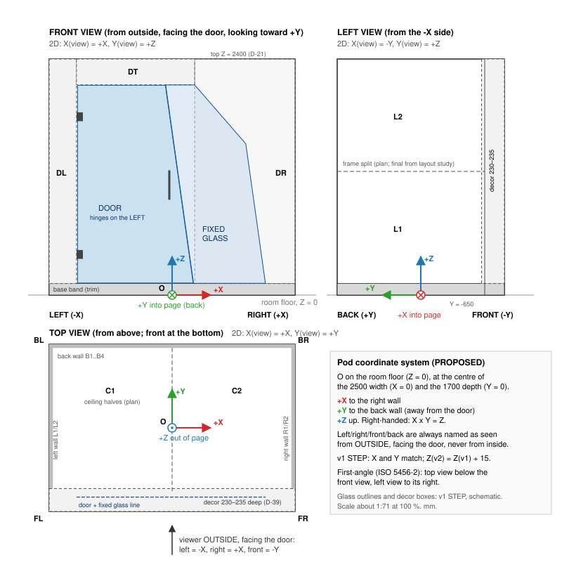

# Conventions for Spaceship (FocusPod v2)

| Doc code | Revision | Status | Date | Owner |
|---|---|---|---|---|
| V2-CTL-005 | P01 | DRAFT. Items marked PROPOSED are working rules until the PM decides them. | 2026-10-31 | Control pack |

Every v2 file follows these rules: CAD, drawings, BOM, registers, assembly guide and packing plan. They come from the engineering guideline (`docs/engineering-guideline.md`, cited as "guideline §n"). Where the guideline leaves a choice open, this file makes it and marks it PROPOSED: a working rule that every file follows until the PM decides it in `decision-log.md`. Nothing waits for outside approval (`AGENTS.md`). The PM's decisions so far are D-01 to D-57. The ones that touch these rules are D-13 (units in STEP files), D-21 (height datum), D-22 and D-28 (part numbers), D-32 (no outside approvals), and D-49 (the decor and wall depth in the key planes, section 4).

Spaceship is the working name for v2 (FocusPod v2). The team calls the product "Indoor Pod", and v1 is "Indoor Pod V3" in `sources/v1/`. Folder names stay as they are.

## 1. Language

- Documents are in English. Next to each part name, give the team's Vietnamese name, for example `WALL - PANEL FRAME - SIDE LOWER - LH` · *Vách trái - khung dưới*.
- Write plain, short sentences. Use the same word for the same thing everywhere (see the vocabulary in `assembly-tree.md`).
- Don't put personal names, supplier quotes or margins in the repo. Refer to people by role: the PM (the Swarm Lead), the hardware engineering lead, the indoor pod lead engineer, the product owner. Public list prices are allowed with a link and the date.

## 2. Units (guideline §3.1)

| Quantity | Unit | Note |
|---|---|---|
| Length | mm | Title blocks say `UNITS: mm`. Don't repeat "mm" after every number on a sheet that declares it. |
| Angle | ° | |
| Mass | kg | Also in the BOM. |
| Force · torque · stress | N · N·m · MPa | |
| Density · areal mass | kg/m³ · kg/m² | MLV and similar sheets are given in kg/m², never as kg/m³ and never as the mass of one sheet. |
| Airflow | l/s | Write m³/h only when you also give l/s. 1 l/s = 3.6 m³/h. |
| Sound | dB, dB(A) | Name the quantity and the standard, for example "D_S,A per ISO 23351-1" or "L_p,A at the seated ear". |
| Gas concentration · power · voltage | ppm · W · V | |

- **Files (D-13, DECIDED):** drawings and DXF are in mm. A STEP file may stay in cm when the file itself declares cm, as Fusion exports do. After every import or export, check the declared unit and measure a known size; never rescale by hand. `AGENTS.md` carries this exception since the sync on main (ISS-066, closed).
- Imperial numbers appear only as reference data in the logistics appendix (07-Packaging), with the metric number that controls next to them. Examples: 48 × 40 in pallet = 1219 × 1016 mm; 6 ft = 1829 mm; 36 × 80 in door = 914 × 2032 mm. Trade names can keep their inch sizes ("48 × 40 in pallet"). The controlling number is always metric.
- Round converted numbers to what the function needs. Don't scale a mm model by 25.4. After any import or export, measure a known dimension again.

## 3. Drawing standard (guideline §3.2)

- **Projection: first-angle**, with the first-angle symbol in every title block. The top view sits below the front view, and the view from the left sits to the right of the front view. Every view states its viewing direction, most of all on left and right handed parts and on views turned away from the installed position.
- **Standards to check** (guideline §3.2). The project Drawing Standard records the edition and amendment actually applied. The editions below are as listed in the guideline and still need checking against the ISO catalogue before release.

| Topic | Standard |
|---|---|
| Dimensions and tolerances | ISO 129-1:2018, plus the applicable amendment |
| Orthographic views (first-angle) | ISO 5456-2:1996 |
| Geometrical tolerancing symbols | ISO 1101:2017 |
| Datums and datum systems | ISO 5459:2024 |
| General tolerances, only where they suit | ISO 2768-1:1989. State the class, and only after the supplier confirms it. |
| General geometrical specification, when needed | ISO 22081:2021, with values, scope and datum system |

- Don't stamp "ISO" and call it done. Don't put ISO 2768-m on everything, and never on wood, PET felt, glass or sandwich panels: those get tolerances from their function and from what the maker can hold. Don't write "ISO 2768-mK": ISO 2768-2 has been withdrawn, and ISO 22081 isn't a drop-in "K" table. Don't mix ISO GPS and ASME readings.
- Other standards named in the v2 plan: ISO 23351-1 for speech level reduction (the sound test of v1 and v2 in the same lab).

## 4. Pod coordinate system (guideline §3.3) — PROPOSED



| Item | Definition |
|---|---|
| Origin O | On the **room floor** the pod stands on (Z = 0), at the centre of the 2500 mm width (X = 0) and the centre of the 1700 mm depth (Y = 0). |
| +X | Toward the **right** wall. |
| +Y | Toward the **back** wall, away from the door. |
| +Z | **Up**. |
| Handedness | Right-handed: X × Y = Z. |
| Front / back | Front is the door and decor side (−Y). Back is the back wall (+Y). |
| Left / right | Named **as seen from outside the pod, standing in front of it and facing the door**. Left is the −X side and right is the +X side. Someone inside, facing the door, has these swapped, so we never name sides from inside or from a camera angle. |
| Top / bottom | Top is +Z (roof). Bottom is the room floor. |

```
                 TOP VIEW (looking down; front at the bottom)

       BL +-------------------- back wall B1..B4 --------------------+ BR
          |                                                          |
          |                            ^ +Y (back)                   |
  LEFT    |  left wall                 |                 right wall  |   RIGHT
  (-X)    |  L1 / L2                   O-----> +X        R1 / R2     |   (+X)
          |                    (O on the room floor, Z = 0)          |
          |                                                          |
          +----------------------------------------------------------+  Y = -650  wall front edge
       FL +=== DL ===[ DOOR (hinges left) ]==[ FIXED GLASS ]=== DR ===+ FR   Y = -850  decor front
                                     ^
                     viewer OUTSIDE, facing the door (looking toward +Y)
                     left = -X   right = +X   front = -Y   up = +Z
```

**Why this origin.** X and Y match the v1 STEP exactly (`sources/v1/indoor-pod-v3-assembly.step` has X = −1250…+1250 and Y = −850 at the front to +850 at the back). So v1 and v2 outlines overlay with no conversion, and that matters because the look must stay the same. Z = 0 moves to the room floor, because the thin floor (D-05) removes the floor frame that v1 measured from.

**v1 to v2:** X(v2) = X(v1), Y(v2) = Y(v1), Z(v2) = Z(v1) + 15. In the v1 STEP, Z = 0 is the underside of the 50×100 floor-frame tubes and the leveling feet reach Z = −15 at their modelled setting. Status: calculation from the v1 STEP.

**Key planes (nominal, working values).**

| Plane | Value | Status · source |
|---|---|---|
| Outer faces of the side walls | X = ±1250 | source: build plan 2500 W |
| Outer face of the back wall | Y = +850 | source: build plan 1700 D |
| Front edge of the side walls (the decor's back plate) | Y = −645 | DECIDED (D-49): wall depth 1495 (850 − 1495, calculation), so the side walls start at the decor's back plate and meet it face to face, keeping v1's side seam (v1: Y −646). Replaces the build plan's 1500 (Y −650); ISS-012. |
| Front-most face of the decor | Y = −850 | DECIDED (D-49): decor blocks 205 mm deep (Y −850 to −645), measured from v1's decor-frame drawing and confirmed in the v1 STEP; replaces D-39's 230–235 and the plan's 200 |
| Top of the roof skin | Z = 2400 | DECIDED (D-21): the build plan's 2400 H, measured from the room floor. v1 is 2405 without feet and 2417 with them (ISS-013, ISS-020). |

**2D views use X and Y only** (guideline §3.3). Each view says how its X and Y map to 3D:

| View (first-angle position) | X(view) → | Y(view) ↑ | Origin of the view |
|---|---|---|---|
| Front, looking toward +Y (principal view) | +X | +Z | O projected |
| Top, looking down (below the front view) | +X | +Y (front at the bottom) | O projected |
| Left side, looking toward +X (right of the front view) | −Y (front to the right) | +Z | O projected |
| Right side, looking toward −X (left of the front view) | +Y (front to the left) | +Z | O projected |
| Rear, looking toward −Y | −X | +Z | O projected |
| Bottom, looking up (above the front view) | +X | −Y (front at the top) | O projected |

Rules:
- A part has its own local system, still called X/Y/Z. Name it after the part (for example `CS-211101`) and state how it sits in the pod system. Part datums A/B/C come from how the part is held and fitted (guideline §6.3). The coordinate origin is not a datum.
- Hole tables have X (mm) and Y (mm) columns only, plus the origin, the positive directions and the face of entry. Depth and drilling direction go in their own columns, never as a Z column.
- Don't use u/v/w or u/v/c as axis names. A/B/C stay datum names, H01… stay hole tags.
- Never mirror, turn or move an origin silently between the CAD, PDF and DXF.

**Position codes** are a separate layer from part names. They say where a panel sits, not which part it is.

| Code | Where | Rule |
|---|---|---|
| L1, L2… | Left wall panels | Count along the row first (front to back), then rows from the bottom up. With the plan's 2-frame split, L1 is the lower frame and L2 the upper. |
| R1, R2… | Right wall panels | Same rule as the left wall. |
| B1…B4 | Back wall panels | Count along the row first (left to right, as seen from outside facing the door), then rows from the bottom up. With the plan's 2 × 2 split, B1 is lower left, B2 lower right, B3 upper left, B4 upper right. |
| C1, C2 | Ceiling panels | Left to right. C1 is the −X half and C2 the +X half. |
| F1, F2… | Floor panels | Left to right, then front to back. |
| DL, DR, DT | Decor blocks | Left, right and top, as in v1 and the build plan. |
| FL, FR, BL, BR | Corners | Front left, front right, back left, back right. |

The panel split isn't final until the layout study chooses it (`v2/05-Engineering/layout-study/`). The counting rules above stay the same whatever split it picks.

## 5. Part names (guideline §4.2)

Pattern: **`[ASSEMBLY] - [FUNCTION/PART] - [LOCATION] - [VARIANT]`**, in capitals, with spaced hyphens between fields. Leave out a field that adds nothing. The Vietnamese name goes in its own field.

| Field | Values |
|---|---|
| ASSEMBLY | POD, BASE, WALL, FRONT, CEILING, LINING, AIR, ELECTRICAL, INTERIOR, PACKAGING, HARDWARE |
| FUNCTION/PART | What it is: PANEL ASSY, PANEL FRAME, SKIN, BACKER, FLOOR PANEL, BASE RAIL, DECOR BLOCK, DOOR LEAF, FIXED GLASS, HINGE, SEAL, FAN, SILENCER, LIGHT… |
| LOCATION | SIDE, BACK, LOWER, UPPER, LEFT, RIGHT, TOP, FRONT, CENTER, or a position code (L1, B3, C2, DL…) |
| VARIANT | LH / RH for mirror pairs, COMMON, or a material or size variant (AL, ST, 8 MM) |

Examples. These numbers only show the format; the master BOM assigns the real ones.

| Part number | Name | Vietnamese |
|---|---|---|
| 210101 | WALL - PANEL ASSY - SIDE LOWER - LH | Vách trái - cụm tấm dưới |
| 211101 | WALL - PANEL FRAME - SIDE LOWER - LH | Vách trái - khung dưới |
| 211301 | WALL - SKIN - SIDE LOWER - LH | Vách trái - tấm ốp alu dưới |
| 350101 | FRONT - DECOR BLOCK - DL | Khung trang trí - khối trái |
| 360101 | FRONT - DOOR LEAF - 8 MM SMOKED | Cửa kính |
| 410101 | CEILING - PANEL ASSY - C1 | Trần - tấm trái |

Rules:
- Use COMMON only when the geometry and every machining step are confirmed identical. Mirror parts are LH and RH, with separate part numbers.
- Assembly roles (START / INTERMEDIATE / END) and position codes (L1, B2…) are separate pieces of information. Don't merge them into one vague name.
- The same name appears in the BOM, the CAD component, the drawing title block, the STEP product name, the DXF and the label on the part.
- A standard part needs maker, exact SKU, size, material or grade, finish and its source document. "M6", "good glue" or "or equal" is not a part definition.

## 6. Part numbers — DECIDED (D-22, D-28)

The guideline asks to keep existing numbers where they still identify the item correctly, and not to renumber for looks. v2 is a new design, so every v2 item gets a new number. The numbers use the familiar 6-digit **FF NNNN** shape, and the bands below apply to **new v2 numbers only** (D-22, D-28). The team's old numbers don't follow them: 110006 and 350011 are parts and 830001 is a bought item.

| FF | Family |
|---|---|
| 10 | POD top level, general items and the installation kit |
| 11 | BASE: thin floor or floor frame, base trim band, base seal, leveling |
| 12 | Reserved. The guideline uses it for FRAME corner posts. v2 has no separate posts, so it stays unused unless they come back. |
| 21 | WALL: side and back panels, their frames, skins, backers and cavity fill |
| 35 | FRONT - DECOR: decor blocks DL, DR, DT and their brackets, and the fans and cartridges inside DR (D-29, D-51). The family code echoes the guideline's FRONT FASCIA numbers; none of those numbers is reused. |
| 36 | FRONT - DOOR AND GLAZING: door leaf, fixed glass, hinges, handle, catch, glazing profiles, door seals |
| 41 | CEILING |
| 51 | LINING: PET felt panels and their fixing |
| 61 | AIR: fans, silencers, vents, grilles |
| 71 | ELECTRICAL: lights, switches, sockets, controller, sensors, wiring, power inlet, and hooks for the voice cockpit kit |
| 81 | INTERIOR: inside trims only. The pod ships empty. |
| 83 | HARDWARE: standard fasteners, inserts, nuts, washers. The family code echoes the guideline's insert and nut numbers; none of those numbers is reused. |
| 84 | SEALS AND TAPES bought by length: gaskets, hook-and-loop, adhesive tapes |
| 91 | PACKAGING: pallets, crates, protection, labels |

| NNNN | Use |
|---|---|
| 0000 | The family's top assembly (for example 210000 WALL) |
| 0001–0999 | Assemblies and subassemblies, including bonded and hardware-fitted ones |
| 1000–7999 | Parts we make |
| 8000–8999 | Bought catalog items used only in this family |
| 9000–9999 | Kits and spares |

Rules:
- One part number for one form, fit and function. A change that breaks interchangeability gets a new number, not just a new revision (guideline §4.2).
- Never reuse a number. A cancelled number stays cancelled in the master BOM.
- Revision and status aren't part of the number.
- The master BOM (`v2/04-BOM/`) assigns numbers. CAD components are named `PARTNO NAME`, for example `211101 WALL - PANEL FRAME - SIDE LOWER - LH`.
- **Never reuse an old number (D-28).** These numbers from the guideline's examples and the earlier V5 attempt are reserved and must not appear as v2 part numbers: 110006, 110002, 120001, 211000, 210001, 210003, 210005, 350011, 830001, 830005. Check every new number against this list first; `check_control_pack.py` enforces it.

**Codes from the input documents are references, never v2 part numbers:**

| Code | Meaning | How to write it in v2 documents |
|---|---|---|
| VT01…VT12 in the build plan | Plan material codes ("vật tư") | "plan VT01" and so on. The plan uses VT03 twice (ISS-007), so write **plan VT03-PET** for the 9 mm felt and **plan VT03-ST** for the 50×100 steel tube until the plan is corrected. |
| VT-01…VT-03 in the v1 BOM | v1 wall screws and inserts (M8×60, M8×40, M8×20 insert) | "v1 VT-01" and so on. These are not plan VT codes (ISS-033). |
| FL-01, LW-04, MUA-03… | v1 BOM line codes | "v1 FL-01" and so on |
| Floor Frame (FL), Left Wall (LW)… | v1 STEP component names | Quote them exactly |

## 7. File names (guideline §4.2) — PROPOSED details

Every file that describes one part or assembly (native CAD, STEP, drawing, DXF, part spec, FAI) is named:

**`PARTNO_REV_DESCRIPTIVE-NAME_DOCTYPE.ext`**

- `PARTNO`: 6 digits (section 6).
- `REV`: the revision code (section 8).
- `DESCRIPTIVE-NAME`: the English part name in capitals, ASCII only, words joined by hyphens, no Vietnamese accents, no spaces. Underscores only separate the four fields.
- `DOCTYPE`: one of `CAD` (native .f3d or .f3z), `STEP`, `DWG` (drawing PDF), `DXF`, `BOM`, `SPEC`, `CALC`, `FAI`, `INS` (assembly instruction), `PKG` (packing), `IMG` (render or screenshot).
- `.ext`: lower case.

Examples: `211101_P01_WALL-PANEL-FRAME-SIDE-LOWER-LH_CAD.f3d` · `211101_P01_WALL-PANEL-FRAME-SIDE-LOWER-LH_STEP.step` · `211101_P01_WALL-PANEL-FRAME-SIDE-LOWER-LH_DWG.pdf`

Rules:
- The revision in the file name, the title block, the BOM and the manifest is always the same.
- Status (DRAFT, HOLD…) is a separate field, never part of the file name.
- Never use final, final2, new, latest, copy, or dates as versions.
- Project documents with no part number (this control pack, studies, registers) keep plain names such as `requirements.md`. Their doc code and revision are in the file header and in `document-register.csv`.
- Phase 0 proof files (`*/proof/`) only test the toolchain. Part files follow this rule from Milestone 2.

## 8. Revisions — PROPOSED

| Code | Meaning |
|---|---|
| P01, P02… | Preliminary revisions: all v2 work until the PM releases a document, including the prototype set |
| R01, R02… | Revisions the PM has released for first-article or production use, each release logged in `decision-log.md` |

- Each change that is issued moves to the next number. No letter suffixes like "Rev01b".
- An agent never turns a P revision into an R revision on its own; only a logged PM decision does. The guideline asks for the code to be proposed before release.
- v1 and V5 revision codes (for example Rev01-FA) are left as they are.

## 9. Status values

**Evidence status of a number.** Every number in v2 documents carries one of these:

| Status | Meaning |
|---|---|
| confirmed | Decided by the PM (logged in `decision-log.md`), or confirmed in writing by the owner of the source (for example the indoor pod lead engineer for his build plan), with where and when |
| source | Copied from a named document (build plan, v1 file, datasheet, standard) and not yet confirmed for v2. Give the document and the page, sheet or cell. |
| calculation | Worked out from sourced or confirmed inputs by a method shown in the file or in a script anyone can re-run |
| assumption | A working value chosen so work can go on. Give the reason. It must be replaced by one of the statuses above before release. |
| unverified | Seen or claimed somewhere (a seller page, a picture measured by eye, memory of a standard) but not checked |
| measured | Reserved for physical measurements (guideline §10): method, instrument, sample, date, by role. None exist yet. |

A PASS or VALIDATED needs its method, conditions, source file and revision, result, and who did it and when (guideline §10).

**Document status** (guideline §4.2), kept in its own field: `DRAFT`, `HOLD`, `REVIEW`, `FA-APPROVED`, `PRODUCTION-APPROVED`. Two more for the register only: `REFERENCE` for files received from outside the project (v1, the build plan), which are read only and never edited; and `PLANNED` for a file or folder another group is writing that isn't in main yet.

**Decision status:** `PROPOSED` is our working answer: the work goes ahead on it until the PM rules. `DECIDED` means the PM has ruled; the decision is logged in `decision-log.md` (D-nn) with its date and reason. Nothing waits for outside approval (`AGENTS.md`). There are no human hardware leads on this project (D-32), and the factory's wall-and-door sample is the physical check.

**Issue status** (`issue-register.csv`): `OPEN` (no answer yet), `PROPOSED` (an answer is proposed and work follows it), `DECIDED` (the PM has ruled, D-nn; work follows), `CLOSED` (the PM's logged decision plus its evidence, linked in the row). Nobody outside the project is waited on (D-32).

**Test status** (guideline §10): `PLANNED`, `NOT TESTED`, `PASS`, `FAIL`. Physical tests stay `PLANNED` or `NOT TESTED` until real data exists.

## 10. Folder layout (guideline §12)

v2 follows the guideline's target folders under `v2/`. Create a folder only when a file with a clear use goes into it.

| Folder | Holds | Status on 2026-10-31 |
|---|---|---|
| `00-Control/` | README, requirements, assembly tree, registers, conventions, open questions, the build plan PDF | This pack |
| `01-CAD-Native/` | Native Fusion files (.f3d or .f3z) with all their dependencies | Phase 0 proof in progress (`proof/`) |
| `02-Drawings/` | `00-General-Assembly/`, `10-Subassemblies/`, `20-Parts/`, `30-Assembly-Instructions/` | Phase 0 proof in progress (`proof/`) |
| `03-Manufacturing/` | STEP, DXF, cut lists, process specs | Phase 0 proof in progress (`proof/`) |
| `04-BOM/` | One master BOM and filtered views of it | Not started (Milestone 2) |
| `05-Engineering/` | Joints, feature rationale, calculations, supplier data | Layout study, hardware selection, and the sound and air check are in progress |
| `06-Verification/` | CAD reports, FAI plan and results, prototype evidence | Not started |
| `07-Packaging/` | Packing drawings, packing BOM, logistics appendix | Not started (the layout study feeds it) |
| `90-Archive/` | Reference copies only, under rules that are approved first | Not used |
| `research/` | Desk research (market study) | Exists. Kept from before this layout. |

`sources/v1/` stays as received and is never edited.
