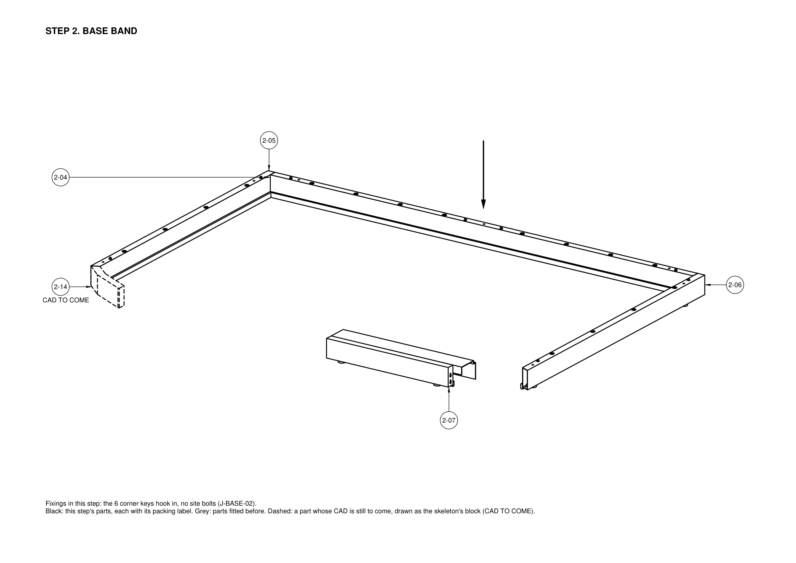
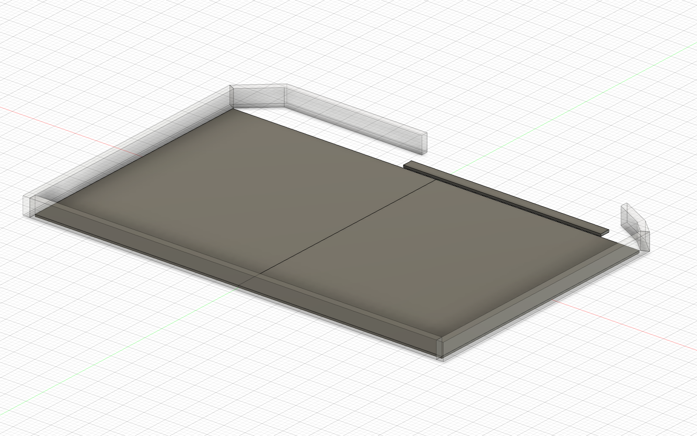
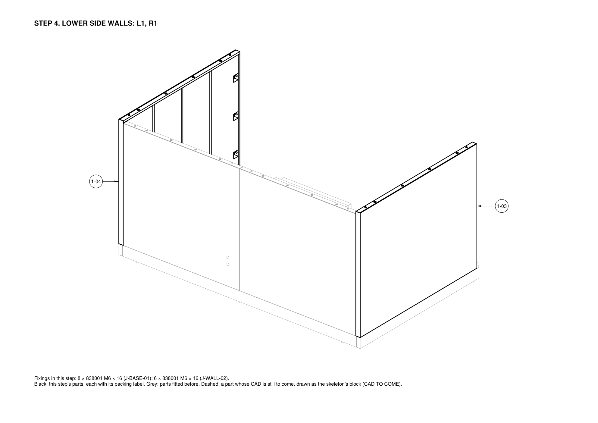
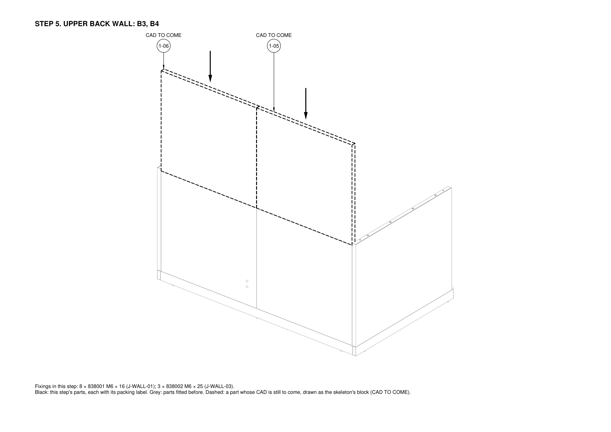
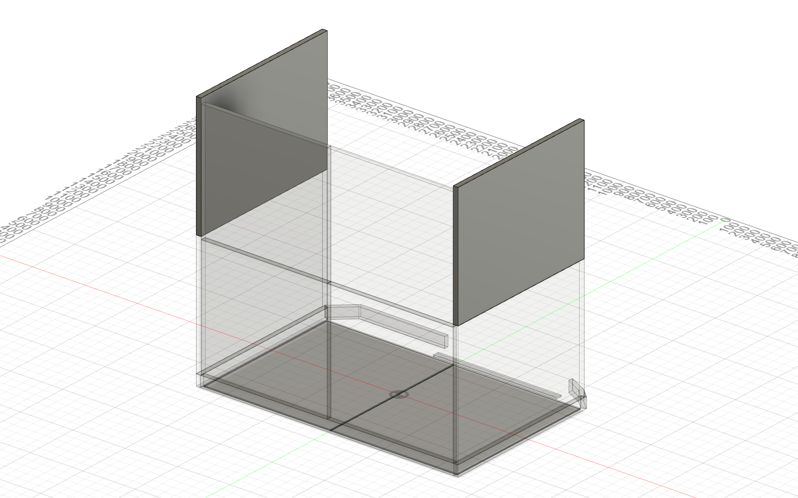
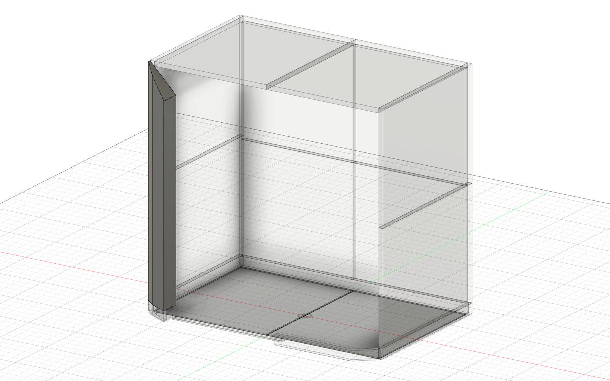
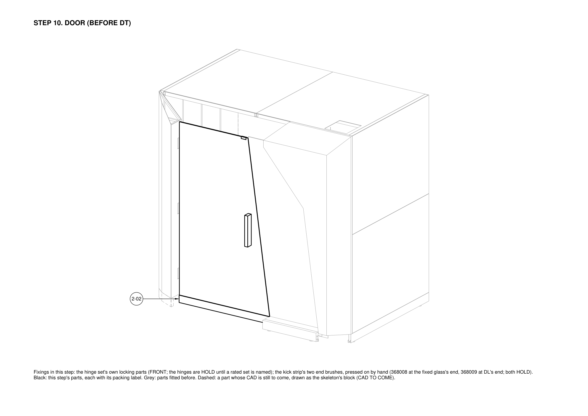
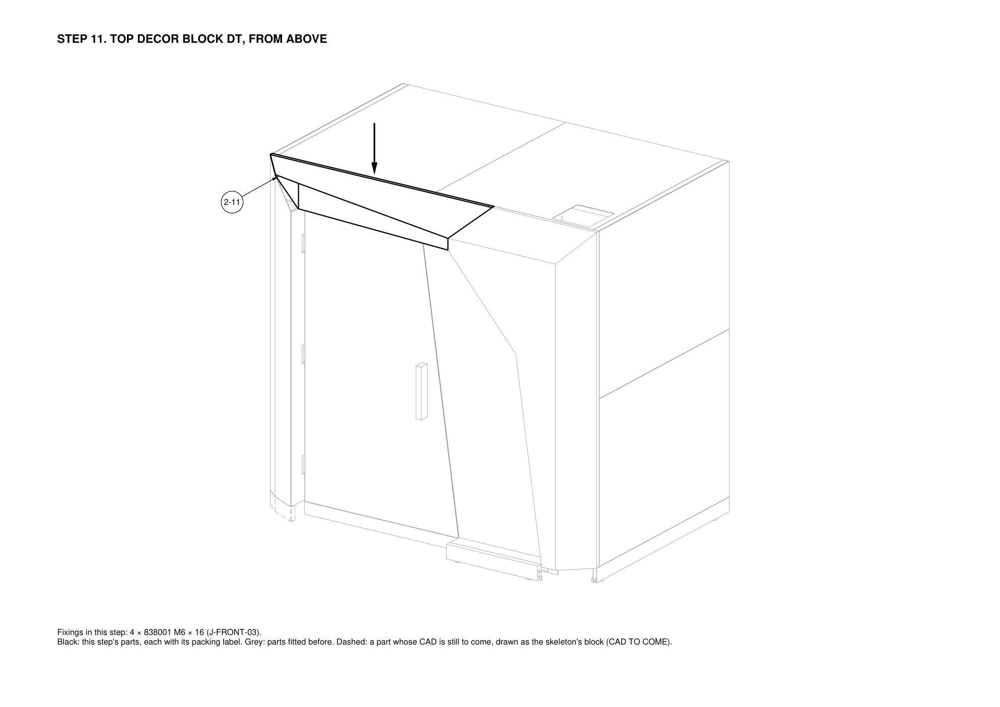
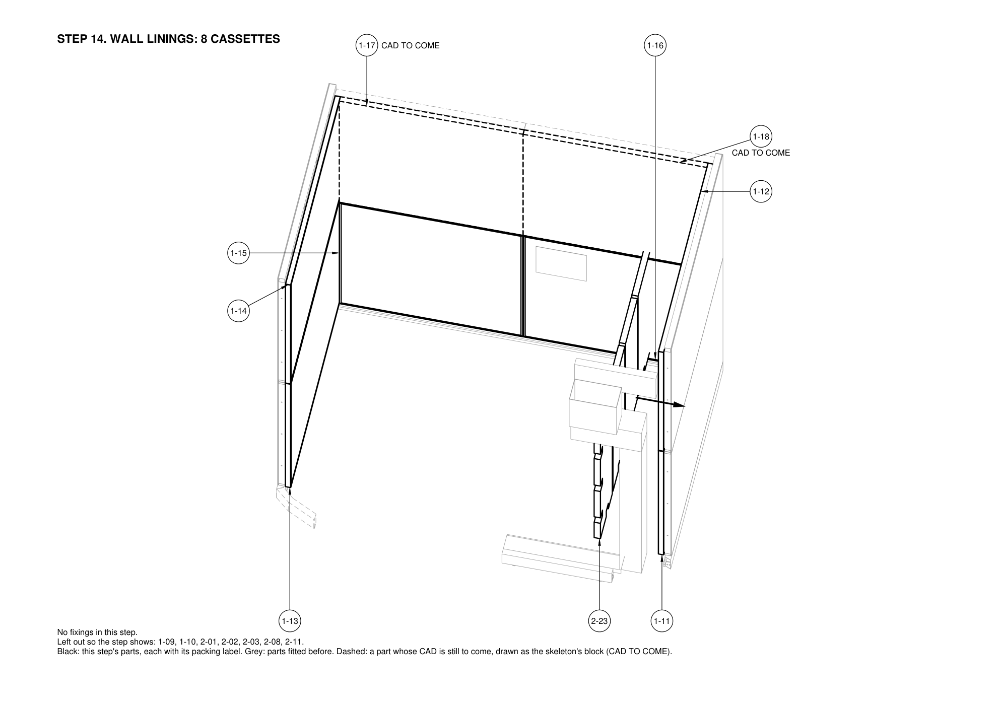
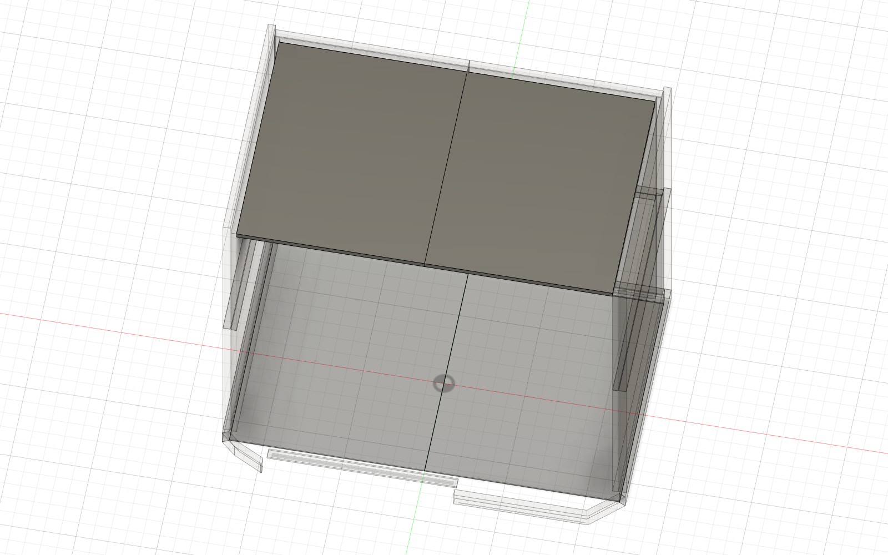

<!-- 100000_P04_POD-ASSEMBLY-GUIDE_INS.md is generated by v2/07-Packaging/pack.py from v2/07-Packaging/templates/assembly-guide.md. Edit the template or the script, never the generated file. -->
# Assembly guide: Spaceship (FocusPod v2), 2 people, one 5 mm hex key

| Doc code | Part number | Revision | Status | Date | Owner |
|---|---|---|---|---|---|
| V2-INS-001 | 100000 POD · Pod hoàn chỉnh | P04 | DRAFT | 2026-10-31 | Packing and Assembly Engineer |

Revision P04 is the pod's own revision: this guide is built on skeleton P04, and the files of part 100000 share one revision (conventions §7 and §8). This is the guide's first issue. It follows the general assembly and the subassembly drawings when they exist and doesn't replace them (guideline §5.1). Labels like **1-05** are the packing labels of [`910000_P01_PACKAGING-PLAN_PKG.md`](../../07-Packaging/910000_P01_PACKAGING-PLAN_PKG.md); every number carries a status (conventions §9).

## Result

1. **Two people, one 5 mm hex key, 22 steps: about 133 minutes (4.4 person-hours)** on the layout study's unit times. That is inside REQ-ASM-01's 4-hour limit and well over its "about 1 hour" target; the timed trial on the prototype decides, and section 6 shows where the time goes.
2. **92 bolts of the joints register, each captive in its part but the roof grille's 4, which come in a bag with the grille (J-AIR-03): 80 × 838001 (M6 × 16) and 12 × 838002 (M6 × 25) pins and lock screws**, each with its 838004 washer already on. They match the register joint by joint (section 5). Every site fixing is in the register now: the corner keys hook in and DL and DR stand on spigots, with no site bolts (J-BASE-02, J-FRONT-02); the door hinges and the air parts' fixings in DR stay on hold there.
3. **Every part weighs 20 kg or less except the glass** (D-03). The door unit (48.8 kg) and the fixed glass (28.7 kg) are carried by both people with 2 suction lifters.
4. **Order rules:** all walls before the front; the ceiling closes by order (its side walls' top corner bolts stay finger-tight until both halves are in, R-J9); the door hangs before DT (PM ruling); DR's bolts are driven before the air column stands (J-FRONT-01); every bolt before the linings that cover its bay.
5. **Pictures:** each step with parts in the skeleton has a picture from the Fusion model (skeleton P04's part envelopes): the step's new parts solid, the parts fitted before faded. Pictures made before D-132 still show the floor panels and the threshold, faded, from step 3 on; the next picture run drops them. The four renders below show the whole pod. Pictures of the real parts replace the envelopes as each part's CAD merges.

| Front, from the right and above | Back, from the left and above |
|---|---|
|  |  |
| **Plan** | **Front base band and DR on the band** |
|  |  |

## 1. Before you start

- **The crew.** Person A leads the lifting and holds each part in place; Person B drives the bolts from inside. Both lift the glass, the long parts and anything overhead.
- **The one tool** is the 5 mm ball-end hex key 108001, in the OPEN FIRST kit (109000, label 2-21). Nothing else counts as a tool (REQ-ASM-03).
- **Handling aids** (not tools: ISS-047, ISS-064): 2 suction lifters (two-cup, each rated 40 kg or more; assumption), 2 step stools with 2 treads, a 600 mm spirit level, a utility knife for straps and film, cut-resistant gloves and safety shoes.
- **The room:** see the [install sheet](100000_P04_POD-INSTALL-SHEET_INS.md): at least 2550 mm clear height, a floor flat within the glides' range, a door at least 810 mm wide (REQ-ASM-06), room round the 2500 × 1700 footprint to lay the parts out, and a 220 V socket for the mains inlet (prototype, REQ-SCP-02), connected by a qualified electrician.
- **Directions:** left and right as seen from outside, facing the door (conventions §4). Position codes: walls L1 and L2 (left, lower and upper), R1 and R2 (right), B1 to B4 (back: lower left, lower right, upper left, upper right); ceiling C1 (left) and C2 (right); decor blocks DL, DR, DT.
- **The clock** (REQ-ASM-01; its start and stop are PROPOSED): it starts with the pallets unwrapped on site and stops with the pod closed, powered and the fans running, after the final check (step 21). Step 22 fits the ledge after the clock.

## 2. Safety

- **Glass.** The door unit is 48.8 kg and the fixed glass 28.7 kg: always both people and both suction lifters. Check each lifter's vacuum before every lift. Get each pane upright by tilting it up in the crate on its padded long edge, both lifters at its top edge, onto the padded glass rest; never lift a pane flat and never turn it on a corner. Carry glass upright, never flat and never over anyone. Set it down only on the padded glass rests or in its channel, never on a corner or a hard floor. Leave the protective film on. The glass stays in its crate until its step.
- **Weight.** Every other part is 20 kg or less (D-03); parts longer than 1.6 m or heavier than 15 kg are carried by both people.
- **Height.** One person on a step stool at a time, the other hands up. The ceiling halves, the soffit, its cartridge, DT and the ceiling linings are lifted by both people.
- **Hands.** Keep fingers off the joint faces while a panel is lowered onto its spigots and while a bolt pulls a seam shut.
- **Bolts.** Hand tools only. The tightening torque is on HOLD until the rivnut test T06 (HOLD-01, D-48): turn until the seam closes onto its stop and the bolt stops; no extension bars, no power drivers.
- **Electrics.** Power stays off until step 20. Only a qualified electrician connects the mains inlet; everything else runs on 12 V (D-10).
- **Packaging.** Hold a strap while cutting it. Keep film and foam off the walking area.

## 3. How the joints work (read once)

- **Captive bolts.** Each bolt sits in the edge tube of the part placed second, with its washer, pulled back and held by a grommet (joints register 2.2). You only turn it: the key goes through the Ø19 hole from the 60 × 60 fill pocket in that panel's bay. The one exception is the roof grille: its 4 bolts go in from the roof with their washers (step 17, J-AIR-03).
- **Spigots.** Every wall and ceiling part stands on two Ø8 spigots, a round hole at one end and a slot at the other, before its first bolt (REQ-ASM-04). If a part doesn't drop on, lift it and seat it again; never force it.
- **Two bolts, one key.** 838001 (M6 × 16) for the 80 other bolts: each pulls its joint onto its 2.26 mm metal stop or its seat. 838002 (M6 × 25) pins at the 10 closing-seam positions (B1–B2, B3–B4, C1–C2): snug only, they hold the faces level and pull nothing (joints register 2.10). Two more lock the soffit on its hanger studs (J-AIR-01).
- **Order of tightening** (joints register 2.7, R-J9): closing-seam pins first, then the stopped seams; the side walls' top corner bolts and the ceiling's side bolts last, once both ceiling halves are in.
- **Linings last.** Every bolt is driven through a bay that a lining cassette covers later, so check each wall's bolts before its cassette goes on.

## 4. Steps

### Step 1. Unpack and set the parts down at their places

- **Time:** about 12 min for 2 people.
- **Parts:** **2-21** POD - INSTALLATION KIT (OPEN FIRST) (3.5 kg).
- **Fasteners:** none.
- **Person A:** Cuts the straps and film on pallet 2 and hands the tiers down, top first: the OPEN FIRST kit and the ceiling cassettes, then tiers 4 to 2. Leaves the glass crate closed on the pallet.
- **Person B:** Sets every part from pallet 2 down at its own place round the pod, as the label map shows, felt and ACP faces up on floor protection; opens the kit (hex key, this guide, label map) and ticks the packing list.
- **Check before the next step:** Every label on the packing list is found and lies at its place. Nothing leans on the glass crate. Pallet 1 stays strapped until step 3.

### Step 2. Base band

- **Time:** about 10 min for 2 people.
- **Parts:** **2-04** BASE - BAND ASSY - BACK (3.4 kg), **2-05** BASE - BAND ASSY - SIDE - LH (2.6 kg), **2-06** BASE - BAND ASSY - SIDE - RH (2.6 kg), **2-07** BASE - BAND ASSY - FRONT - FIXED GLASS (2.5 kg), **2-14** BASE - SMALL PARTS CARTON (1.1 kg).
- **Fasteners:** the 6 corner keys hook in, no site bolts (J-BASE-02).
- **Person A:** Sets the left and right side bands on their glides. Then, with B at the other end, lowers the back band straight down between them: the slots in its end caps take both side bands' back-corner studs from below, and it comes to rest on its own glides (D-129). Then the front pieces, each offered 10 mm high, pushed along its studs and lowered onto its glides: FL1, then FL2 at the knee (under DL), then the intake support rail with the mesh intake piece under DR, DR's support and the closing plate, and last FR1, the piece under the fixed glass, onto the rail (J-BASE-02).
- **Person B:** Checks the band with the spirit level, corner to corner, and turns only the glides that are out, from above with the hex key. The glides come preset from the factory (D-87); the glide is HOLD and must take the same 5 mm key (REQ-ASM-03). Then, with A, lays a PE sheet from the packing over the room floor inside the band, clear of the soft lip, for the rest of the work: the room floor is the pod's floor now (D-132).
- **Caution:** Nobody lifts the back band or stands on it until B1 and B2 bolt through its top wall in step 3: until then only its weight holds it on the studs (J-BASE-02).
- **Check before the next step:** Band level within the spirit level's bubble; the back band resting on its glides with both end caps down over the studs; every front piece hooked home; the soft lip on the band's inner face touches the room floor all round (D-132); the mesh piece's support stands; the fixed glass's U-channel, fitted on the sill at the factory, is clean and undamaged.

### Step 3. Lower back wall: B1, B2

- **Time:** about 4 min for 2 people.
- **Parts:** **1-01** WALL - PANEL ASSY - BACK LOWER - B1 (8.6 kg), **1-02** WALL - PANEL ASSY - BACK LOWER - B2 (12.1 kg).
- **Fasteners:** 8 × 838001 M6 × 16 (J-BASE-01); 3 × 838002 M6 × 25 (J-WALL-03). Tool: the 5 mm hex key.
- **Person A:** Stands B1 on its band spigots (round hole and slot), skin out, and holds it upright; then B2 the same, against B1. B2 carries the power unit, wired and tested at the factory (11.6 kg).
- **Person B:** From inside, through the fill pockets: first the 3 pins of the B1-B2 closing seam, snug only; then B1's and B2's 4 base bolts each (pins first: joints register 2.7, R-J11).
- **Check before the next step:** Both panels sit down on their stops; the B1-B2 gap looks even top to bottom (5.5 mm nominal).

### Step 4. Lower side walls: L1, R1

- **Time:** about 4 min for 2 people.
- **Parts:** **1-03** WALL - PANEL ASSY - SIDE LOWER - LH (11.2 kg), **1-04** WALL - PANEL ASSY - SIDE LOWER - RH (11.2 kg).
- **Fasteners:** 8 × 838001 M6 × 16 (J-BASE-01); 6 × 838001 M6 × 16 (J-WALL-02). Tool: the 5 mm hex key.
- **Person A:** Stands L1 on its band spigots against B1's edge and holds it; then R1 against B2.
- **Person B:** Drives the 4 base bolts of each, then the 3 lower back-corner bolts each side (L1-B1, R1-B2), from the back panels' bays.
- **Check before the next step:** Corners closed onto their stops; side panels' front edges in line with the band's front end.

### Step 5. Upper back wall: B3, B4

- **Time:** about 4 min for 2 people.
- **Parts:** **1-05** WALL - PANEL ASSY - BACK UPPER - B3 (8.6 kg), **1-06** WALL - PANEL ASSY - BACK UPPER - B4 (8.6 kg).
- **Fasteners:** 8 × 838001 M6 × 16 (J-WALL-01); 3 × 838002 M6 × 25 (J-WALL-03). Tool: the 5 mm hex key.
- **Person A:** Lifts B3 onto B1's top spigots (step stool), then B4 onto B2's, dropping past the closing seam's lead-in chamfer.
- **Person B:** First the 3 pins of the B3-B4 closing seam, snug only; then the 4 horizontal-seam bolts under each (B1-B3, B2-B4).
- **Check before the next step:** Seams closed; skins flush across the horizontal seam.

### Step 6. Upper side walls: L2, R2

- **Time:** about 4 min for 2 people.
- **Parts:** **1-07** WALL - PANEL ASSY - SIDE UPPER - LH (11.3 kg), **1-08** WALL - PANEL ASSY - SIDE UPPER - RH (11.3 kg).
- **Fasteners:** 8 × 838001 M6 × 16 (J-WALL-01); 6 × 838001 M6 × 16 (J-WALL-02). Tool: the 5 mm hex key.
- **Person A:** Lifts L2 onto L1's spigots against B3's edge, then R2 onto R1 against B4.
- **Person B:** Drives the 4 horizontal-seam bolts each (L1-L2, R1-R2), then the 3 upper back-corner bolts each side (L2-B3, R2-B4) FINGER-TIGHT only.
- **Check before the next step:** The 6 upper corner bolts are finger-tight, so the wall tops can follow the ceiling (R-J9).

### Step 7. Ceiling: C1, C2

- **Time:** about 10 min for 2 people.
- **Parts:** **1-09** CEILING - PANEL ASSY - C1 (10.0 kg), **1-10** CEILING - PANEL ASSY - C2 (10.9 kg).
- **Fasteners:** 4 × 838002 M6 × 25 (J-CEIL-02); 16 × 838001 M6 × 16 (J-CEIL-01). Tool: the 5 mm hex key.
- **Person A:** With B on a second stool, lifts C1 from inside onto its back spigots (on B3), its side against L2; then C2 the same, dropping past C1's lead-in. C2 carries the roof slot.
- **Person B:** Drives the 4 pins of the C1-C2 closing seam, then the 8 back-edge bolts up from the back panels' top bays, then the 8 side-edge bolts; last, tightens the 6 upper corner bolts left finger-tight in step 6.
- **Check before the next step:** Ceiling seams closed; the C1-C2 gap even (4.3 to 6.7 mm); all 6 upper corner bolts now tight.

### Step 8. Left decor block DL

- **Time:** about 2 min for 2 people.
- **Parts:** **2-08** FRONT - DECOR BLOCK ASSY - DL (12.3 kg).
- **Fasteners:** 6 × 838001 M6 × 16 (J-FRONT-01); DL stands on its spigots on the band, no bolts (J-FRONT-02). Tool: the 5 mm hex key.
- **Person A:** With B, carries DL (2.3 m) from its place to the front-left and stands it on its spigots on the band, against L1 and L2's front edges, hinge halves toward the door opening.
- **Person B:** Drives 3 bolts into DL from each of L1's and L2's front bays (6). DL stands on its spigots on the band and needs no bolt there (J-FRONT-02).
- **Check before the next step:** DL plumb (spirit level on its door-side face); the hinge halves free.

### Step 9. Fixed glass, then the right decor block DR

- **Time:** about 13 min for 2 people.
- **Parts:** **2-01** FRONT - FIXED GLASS UNIT (28.7 kg), **2-03** FRONT - DECOR BLOCK ASSY - DR (18.9 kg).
- **Fasteners:** 6 × 838001 M6 × 16 (J-FRONT-01); DR stands on its spigots on its support, no bolts (J-FRONT-02). Tool: the 5 mm hex key.
- **Person A:** Opens the crate. With B, tilts the fixed glass up on its padded long edge, both suction lifters at its top edge, onto the padded glass rest; then both carry it upright and drop its bottom edge into the U-channel already fitted on the sill, onto its setting blocks. A clamps the 2 glass stays from the kit on its top edge and sets their props on the base band, so the glass stands on its own.
- **Person B:** With A, carries DR (2.3 m, 18 kg) to the right of the opening; both slide it in from the side so its channels take the glass's right and diagonal edges, back onto its stops. Drives 3 bolts into DR from each of R1's and R2's front bays (6); DR stands on its spigots on its support (J-FRONT-02). Only then do the stays come off.
- **Caution:** Nobody carries DR alone and nobody holds the glass by hand while DR comes in: the stays hold the glass, both people carry DR (2.3 m; the 2-person rule).
- **Check before the next step:** Glass seated in all three channels so far, its free edge plumb; DR on its stops; both stays back in the kit. Do this before the air column: DR's right-hand bolts can't be reached once it stands (J-FRONT-01).

### Step 10. Door (before DT)

- **Time:** about 9 min for 2 people.
- **Parts:** **2-02** FRONT - DOOR UNIT (48.8 kg).
- **Fasteners:** the hinge set's own locking parts (FRONT; the hinges are HOLD until a rated set is named).
- **Person A:** Stacks setting packers from the kit on the room floor where the door's bottom corners land, each stack as high as the base band's bottom edge beside it (about 10 mm; the door's kick strip hangs on that line and the room floor is not flat, D-132). With B, tilts the door unit up in the crate on its padded long edge, both suction lifters at its top edge (each lifts about 12 kg at the start), onto the padded glass rest; then both carry it upright (about 25 kg each) and stand it on the packers, so its hinge halves meet DL's at their height, and lower them on.
- **Person B:** Secures the hinges as the named set requires (HOLD), slides the packers out, then swings the door slowly to 90 degrees and back, checking that its kick strip runs level with the band's bottom edge, about 10 mm over the room floor, and that the drop seal comes down onto the floor when it closes (D-132). The hinges hold the door at its closed position; there is no lock (D-83).
- **Check before the next step:** The door hangs before DT goes on: DT's underside is only 4 mm above the door top (PM ruling). Door swings freely, no rub.

### Step 11. Top decor block DT, from above

- **Time:** about 3 min for 2 people.
- **Parts:** **2-11** FRONT - DECOR BLOCK ASSY - DT (7.9 kg).
- **Fasteners:** 4 × 838001 M6 × 16 (J-FRONT-03). Tool: the 5 mm hex key.
- **Person A:** From a step stool outside the front, with B on a second stool, lowers DT from above onto DL and DR so its slot takes the glass's top edge.
- **Person B:** Drives DT's 4 bolts to the ceiling (J-FRONT-03).
- **Check before the next step:** The glass's top edge is in DT's channel; 4 mm head gap over the door all along; the top band line straight; the door's strike 368102 closes onto the 35 N magnetic catch 368007 in DT's underside (D-83).

### Step 12. Electrics, first fix (power off)

- **Time:** about 1 min for 2 people.
- **Parts:** **2-12** ELECTRICAL - KIT - HARNESS, CORD SET, HUB ZONE, LIGHTS (2.4 kg).
- **Fasteners:** none.
- **Person A:** Plugs the factory-tested harness together at each panel seam and runs the plug-in feeds for the light shelf and the hub to their ends (D-87).
- **Person B:** Hands parts from the electrical kit and checks each connector against the wiring diagram (ELECTRICAL design).
- **Check before the next step:** Every seam connector latched before any cassette closes its bay.

### Step 13. Air parts in DR: the intake riser with its supply fan box

- **Time:** about 4 min for 2 people.
- **Parts:** **2-16** AIR - SUPPLY FAN BOX (13.4 kg).
- **Fasteners:** their fixings in DR (AIR and FRONT design, on hold).
- **Person A:** Before the wall linings (DR's inner face can't come off past R1's and R2's cassettes), lifts DR's removable inner face off; with B, slides in the intake riser, its supply fan box (2 fans) joined at its top in the factory, down to its foot over the mesh space (D-87).
- **Person B:** Mates the fan box's plug-in connector; refits the inner face.
- **Check before the next step:** Riser foot sits over the opening; fan box connector latched; inner face back on all round.

### Step 14. Wall linings: 8 cassettes

- **Time:** about 8 min for 2 people.
- **Parts:** **1-11** LINING - CASSETTE - SIDE LOWER - RH (10.3 kg), **1-12** LINING - CASSETTE - SIDE UPPER - RH (9.9 kg), **1-13** LINING - CASSETTE - SIDE LOWER - LH (10.3 kg), **1-14** LINING - CASSETTE - SIDE UPPER - LH (9.9 kg), **1-15** LINING - CASSETTE - BACK LOWER - B1 (8.0 kg), **1-16** LINING - CASSETTE - BACK LOWER - B2 (8.0 kg), **1-17** LINING - CASSETTE - BACK UPPER - B3 (8.4 kg), **1-18** LINING - CASSETTE - BACK UPPER - B4 (8.4 kg).
- **Fasteners:** none.
- **Person A:** Hangs R1's and R2's cassettes first (the air column needs them), then L1, L2, B1 to B4, each on its clips. DR's inner face is already back on: it can't come off past R1's and R2's cassettes (the PM's ruling).
- **Person B:** Hands each cassette up felt-out and lines it up with the hook-and-loop; checks each clip has locked.
- **Check before the next step:** Every bolt in its bay was driven before the bay is closed. Each cassette floats: it touches nothing but its clips.

### Step 15. Air column and supply cartridge

- **Time:** about 7 min for 2 people.
- **Parts:** **2-10** AIR - AIR COLUMN (8.1 kg), **2-17** AIR - SPLITTER CARTRIDGE - COMMON (10.6 kg).
- **Fasteners:** the column hangs on its 2 factory-set hook studs and stands on 2 spigots, no site bolts (J-AIR-02).
- **Person A:** With B, hangs the air column (2.1 m) on its tool-free hooks in the front-right corner (D-87), its back on DR's inner face and its right side on R1's and R2's linings; lifts its front face off.
- **Person B:** With A, slides the supply cartridge into the column; plugs the hub into the cable chase; A refits the front face.
- **Check before the next step:** Kick grille clear at the floor; the hub zone at about Z 1200 faces the room.

### Step 16. Soffit and exhaust cartridge

- **Time:** about 6 min for 2 people.
- **Parts:** **2-09** AIR - SOFFIT (14.8 kg), **2-18** AIR - SPLITTER CARTRIDGE - COMMON (10.6 kg).
- **Fasteners:** 2 × 838002 M6 × 25 (J-AIR-01). Tool: the 5 mm hex key.
- **Person A:** With B, both on step stools, lifts the soffit (2.3 m), its exhaust fan box already fitted at the right end (D-87), and hangs it on its 4 hanger studs, set in the ceiling frame at the factory, the fan box under C2's roof slot.
- **Person B:** Drives the soffit's 2 captive lock screws with the 5 mm key (J-AIR-01); with A, lifts the exhaust cartridge in through the open underside; plugs the fan box; closes the hinged underside.
- **Check before the next step:** Soffit underside at Z 2120, level; the fan box's top gasket square under the roof slot; the door still clears.

### Step 17. Roof sleeve and grille

- **Time:** about 3 min for 2 people.
- **Parts:** the roof sleeve 611601 and the roof grille 611602 with its 4 bolts and washers in their bag, which came off C2 (1-10) at unpacking.
- **Fasteners:** 4 × 838001 M6 × 16 (J-AIR-03). Tool: the 5 mm hex key.
- **Person A:** From a step stool outside the front right corner, drops the roof sleeve down through C2's roof slot onto the soft gasket on the exhaust fan box's top, its flange on the roof (#263); then lays the roof grille on over it and drives its 4 bolts, each with its washer, into the rivnuts in the sleeve's flange with the 5 mm key, snug (J-AIR-03).
- **Person B:** Inside, opens the soffit's hinged underside and checks from below that the sleeve sits square on its gasket all round; closes the underside.
- **Check before the next step:** Sleeve square on its gasket all round; grille flat on the flange, its 4 bolts snug; no light through the slot with the pod lit.

### Step 18. Ceiling linings: 2 cassettes

- **Time:** about 7 min for 2 people.
- **Parts:** **2-19** LINING - CASSETTE - CEILING - COMMON (9.5 kg), **2-20** LINING - CASSETTE - CEILING - COMMON (9.5 kg).
- **Fasteners:** none.
- **Person A:** With B, lifts each ceiling cassette from below, fill side up, onto its clips behind the soffit.
- **Person B:** Hooks the 2 safety catches of each cassette before A lets go.
- **Check before the next step:** Both catches on each cassette; front edges 3 mm behind the soffit.

### Step 19. Light shelf

- **Time:** about 6 min for 2 people.
- **Parts:** **2-13** INTERIOR - LIGHT SHELF ASSY (1.6 kg).
- **Fasteners:** the light shelf's fixings (INTERIOR's parts list 810201 names none yet).
- **Person A:** Fits the light shelf along the tops of the side and back walls: the back shelf, the two side shelves, and the down-light channel with its diffuser on the right wall (INTERIOR 810201).
- **Person B:** Plugs the light shelf feed.
- **Check before the next step:** Shelves straight; no cable shows.

### Step 20. Power on and self-test: fans run

- **Time:** about 3 min for 2 people.
- **Parts:** none.
- **Fasteners:** none.
- **Person A:** A qualified electrician connects the mains inlet (220 V for the prototype, REQ-SCP-02) and switches on.
- **Person B:** Presses the hub's self-test button: both fan pairs, the lights and the sensors run, and it shows pass or fail (D-87). Then checks air out at the kick grille and into the soffit grille, and the CO2 reading.
- **Check before the next step:** Self-test passes and the fans run on both paths. The clock stops after the final check, the next step (REQ-ASM-01: closed, powered, fans running).

### Step 21. Final check and film

- **Time:** about 13 min for 2 people.
- **Parts:** none.
- **Fasteners:** none.
- **Person A:** Checks the door: swing to 90 degrees, no rub, closes onto DT's magnetic catch 368007 with the magnetic seal pair meeting on the glass edges (D-83), drop seal down on the room floor when closed (D-132).
- **Person B:** Checks the seals with the pod lit and the room dark: no light at any seam. Pulls each of the 15 film panels off by its quick-release tab (the 8 wall skins, the 3 decor blocks, both faces of both glass panes; D-87); lifts the floor sheet; cleans.
- **Check before the next step:** Every check in the final check list is ticked.

### Step 22. Work-wall ledge and screen rail, after the clock

- **Time:** about 8 min for 2 people.
- **Parts:** **2-15** INTERIOR - WORK WALL LEDGE ASSY (1.9 kg).
- **Fasteners:** the ledge's 2 brackets 818101 on R1's stiles, on stand-offs through R1's cassette, and the screen rail 818102 on stand-offs to R2's stiles (INTERIOR; both HOLD).
- **Person A:** Holds the 1000 mm ledge on the right (work) wall's lower panel R1, on its 2 brackets.
- **Person B:** Fixes the ledge's brackets to R1's stiles and the screen rail to R2's stiles (INTERIOR 810101 and 818102, D-70).
- **Check before the next step:** Ledge level and firm.

## 5. Bolts against the joints register

The guide's register bolts, joint by joint, against `v2/05-Engineering/joints/joints-register.md` section 3.9:

| Joint | Bolt | Where in this guide | Guide | Register | Match |
| --- | --- | --- | ---: | ---: | --- |
| J-AIR-01 | 838002 M6 × 25 | step 16: 2 | 2 | 2 | yes |
| J-AIR-02 | 838001 M6 × 16 |  | 0 | 0 | yes |
| J-AIR-03 | 838001 M6 × 16 | step 17: 4 | 4 | 4 | yes |
| J-BASE-01 | 838001 M6 × 16 | step 3: 8, step 4: 8 | 16 | 16 | yes |
| J-BASE-02 |  M6 × 12 |  | 0 | 0 | yes |
| J-CEIL-01 | 838001 M6 × 16 | step 7: 16 | 16 | 16 | yes |
| J-CEIL-02 | 838002 M6 × 25 | step 7: 4 | 4 | 4 | yes |
| J-FRONT-01 | 838001 M6 × 16 | step 8: 6, step 9: 6 | 12 | 12 | yes |
| J-FRONT-02 | 838001 M6 × 16 |  | 0 | 0 | yes |
| J-FRONT-03 | 838001 M6 × 16 | step 11: 4 | 4 | 4 | yes |
| J-FRONT-04 | 838001 M6 × 16 |  | 0 | 0 | yes |
| J-WALL-01 | 838001 M6 × 16 | step 5: 8, step 6: 8 | 16 | 16 | yes |
| J-WALL-02 | 838001 M6 × 16 | step 4: 6, step 6: 6 | 12 | 12 | yes |
| J-WALL-03 | 838002 M6 × 25 | step 3: 3, step 5: 3 | 6 | 6 | yes |
| **Total** | 80 × M6 × 16, 12 × M6 × 25 |  | **92** | **92** | yes |

Joints with no site bolts, and the fixings still on hold or not designed (the joints register's section 3.9 and its HOLD list):

| Step | Fixing | Owner | Count used here | Size | Status | Note |
| ---: | --- | --- | ---: | --- | --- | --- |
| 2 | Base band corner keys (6 keys; the side bands carry the back-corner keys, D-129) | BASE | 0 | none on site: hook studs and fixing bolts in the factory | registered: J-BASE-02 (0 on site, 20 in the factory) | D-87: the keys hook in; part numbers 111211 to 111214 (joints register) |
| 8 | DL on the base band | FRONT and BASE | 0 | none: spigots | registered: J-FRONT-02 (spigots) | DL stands on its spigots; its bolts are J-FRONT-01's, into the side walls |
| 9 | DR on its support behind the mesh band piece | FRONT and BASE | 0 | none: spigots | registered: J-FRONT-02 (spigots) | D-62: the block's own support carries it; the mesh carries no load |
| 10 | Door hinges on DL | FRONT | 0 | per the named hinge set (HOLD) | HOLD in the register (D-46, ISS-002) | time is in the door step; the hinge halves that sit in DL ship fitted in DL (PM) |
| 13 | Intake riser and supply fan box in DR | AIR and FRONT | 0 | not designed yet (HOLD) | HOLD in the register | time is in the step |
| 15 | Air column on DR and the floor | AIR | 0 | none on site: 2 hook studs set in the factory, 2 spigots | registered: J-AIR-02 (0 on site) | D-87: the column hangs on its hook studs |
| 19 | Light shelf | INTERIOR | 0 | not in INTERIOR's parts list yet (HOLD) | HOLD (D-70) | time is in the step |
| 22 | Ledge and screen rail | INTERIOR | 0 | brackets and rail on HOLD; screws not listed yet | HOLD (D-70, IF-16) | time is in the step |

## 6. Time

| Step | What | Pieces | Register bolts | Other fixings | 2-person min | 1-person min (shared) | Elapsed min |
| ---: | --- | ---: | ---: | ---: | ---: | ---: | ---: |
| 1 | Unpack and set the parts down at their places | 1 | 0 | 0 | 10.0 | 0.0 | **11.5** |
| 2 | Base band | 5 | 0 | 0 | 7.7 | 1.3 | **9.6** |
| 3 | Lower back wall: B1, B2 | 2 | 11 | 0 | 0.7 | 4.8 | **3.5** |
| 4 | Lower side walls: L1, R1 | 2 | 14 | 0 | 0.7 | 5.7 | **4.0** |
| 5 | Upper back wall: B3, B4 | 2 | 11 | 0 | 0.7 | 4.8 | **3.5** |
| 6 | Upper side walls: L2, R2 | 2 | 14 | 0 | 0.7 | 5.7 | **4.0** |
| 7 | Ceiling: C1, C2 | 2 | 20 | 0 | 4.0 | 9.3 | **9.9** |
| 8 | Left decor block DL | 1 | 6 | 0 | 1.1 | 1.8 | **2.3** |
| 9 | Fixed glass, then the right decor block DR | 2 | 6 | 0 | 8.7 | 4.8 | **12.7** |
| 10 | Door (before DT) | 1 | 0 | 0 | 7.3 | 1.5 | **9.3** |
| 11 | Top decor block DT, from above | 1 | 4 | 0 | 2.3 | 1.2 | **3.4** |
| 12 | Electrics, first fix (power off) | 1 | 0 | 0 | 0.0 | 2.3 | **1.3** |
| 13 | Air parts in DR: the intake riser with its supply fan box | 1 | 0 | 0 | 2.3 | 2.3 | **4.0** |
| 14 | Wall linings: 8 cassettes | 8 | 0 | 0 | 0.0 | 14.0 | **8.0** |
| 15 | Air column and supply cartridge | 2 | 0 | 0 | 4.7 | 2.3 | **6.7** |
| 16 | Soffit and exhaust cartridge | 2 | 2 | 0 | 4.7 | 1.9 | **6.5** |
| 17 | Roof sleeve and grille | 0 | 4 | 0 | 0.0 | 5.7 | **3.3** |
| 18 | Ceiling linings: 2 cassettes | 2 | 0 | 0 | 4.0 | 4.7 | **7.3** |
| 19 | Light shelf | 1 | 0 | 0 | 0.3 | 10.0 | **6.1** |
| 20 | Power on and self-test: fans run | 0 | 0 | 0 | 3.0 | 0.0 | **3.4** |
| 21 | Final check and film | 0 | 0 | 0 | 10.0 | 2.0 | **12.6** |
| 22 | Work-wall ledge and screen rail | 1 | 0 | 0 | 2.0 | 10.3 | **8.2** (after) |
|  | **Clock, steps 1 to 21** |  | 92 | 0 |  |  | **133** |

Each step's time is its 2-person work plus half its 1-person work (shared between the two), plus 15% for hand-offs, the layout study's model (`scripts/assembly.py`). Where the time goes:

1. Step 9 (Fixed glass, then the right decor block DR): 13 min.
2. Step 21 (Final check and film): 13 min.
3. Step 1 (Unpack and set the parts down at their places): 12 min.
4. Step 7 (Ceiling: C1, C2): 10 min.
5. Step 2 (Base band): 10 min.

**D-87 (PM, 2026-10-31) cut the clock from 168 minutes (PR #52) to the 133 above.** The PM took four of the five fixes priced on the earlier model, and they are in the steps now:

| Fix | Steps | Priced on the 168-minute model | Owner |
|---|---|---:|---|
| The exhaust fan box fitted inside the soffit and the intake riser joined to the supply fan box at the factory, plug-in connectors, tool-free hooks for the soffit and the column, one hinged soffit underside | 13, 15 and 16 | 11.4 min (calculation) | AIR (CEILING Engineer), FRONT |
| Glides preset at the factory, corner keys that hook in (12 fewer bolts), band pieces that locate on the keys | 2 | 11.8 min (calculation) | BASE, Joints Engineer |
| The floor foam bonded under the floor panels at the factory (D-132 then removed the floor), and every pallet 2 part set down at its place in step 1 | 1 and every carry | 10.7 min (calculation) | Packing, BASE |
| A factory-tested plug-in harness and a self-test button on the hub | 12 and 20 | 8.1 min (calculation) | ELECTRICAL |

The fifth, moving the film peeling after the clock, was rejected so the number stays honest. Instead the film covers only the 15 faces that show (the 8 wall skins, the 3 decor blocks and both faces of both glass panes; none on the roof skins) and each panel has a quick-release tab. Peeling now takes about 0.9 minutes of the clock, against 3.3 for film on all 17 faces without tabs: 2.4 minutes saved. The layout study's 168 minutes didn't count film at all, so this is time the clock now carries honestly.

The 1-hour target needs more than this: the timed trial showing faster unit times than the layout study assumed, or fewer loose pieces and bolts. The 92 register bolts alone take about 16 minutes of the clock. For scale, hushMeet takes 2 installers 2.5 to 3 hours (source: the market study, as the layout study §4 quotes it).

Unit times used:

| Name | Value | Status | Source | What it is |
| --- | --- | --- | --- | --- |
| `t_unpack_std_ordered_min` | 4 min | assumption | layout study `scripts/inputs.py` | 48x40 packed in assembly order, parts numbered |
| `t_unpack_long_ordered_min` | 6 min | assumption | layout study `scripts/inputs.py` | long pallet packed in assembly order |
| `t_carry_s` | 45 s | assumption | layout study `scripts/inputs.py` | carry one part from the pallet to its place |
| `t_place_s` | 45 s | assumption | layout study `scripts/inputs.py` | set one wall/floor part on its locating pins |
| `t_place_hung_s` | 20 s | assumption | layout study `scripts/inputs.py` | panel hung on hooks or seated on pins holds itself: no second person holding |
| `t_place_overhead_s` | 120 s | assumption | layout study `scripts/inputs.py` | lift and set one ceiling half, 2 people, step stool |
| `t_bolt_captive_s` | 18 s | assumption | layout study `scripts/inputs.py` | captive M6 bolt already started in its panel: no picking up, no dropping |
| `t_level_min` | 10 min | assumption | layout study `scripts/inputs.py` | level the base with glides and a spirit level |
| `t_fixed_preglazed_min` | 5 min | assumption | layout study `scripts/inputs.py` | fixed glass arrives in its profile frame: set and fix the frame |
| `t_door_prehung_min` | 6 min | assumption | layout study `scripts/inputs.py` | door arrives hung on the left decor post: set the post, check swing |
| `t_connector_s` | 20 s | assumption | layout study `scripts/inputs.py` | mate one plug-in cable connector at a panel seam |
| `t_leaf_s` | 60 s | assumption | layout study `scripts/inputs.py` | clip one inner leaf (sound mass + felt) onto its frame from inside |
| `t_elec_min` | 10 min | assumption | layout study `scripts/inputs.py` | plug seam connectors and power, test fans and lights |
| `t_final_min` | 10 min | assumption | layout study `scripts/inputs.py` | check door swing and seals, clean |
| `inefficiency` | 0.15 - | assumption | layout study `scripts/inputs.py` | added to elapsed time for hand-offs and checking |
| `t_dr_slide_s` | 120 s | assumption | this plan | slide DR in from the side onto the fixed glass's right and diagonal edges and onto its stops |
| `t_slide_long_s` | 120 s | assumption | this plan | slide one long air part (riser or cartridge) into its housing, 2 people |
| `t_face_s` | 60 s | assumption | this plan | lift one felt-covered face or section off, or back on |
| `t_catch_s` | 60 s | assumption | this plan | hook one ceiling cassette safety catch (HOLD, D-47) |
| `t_light_shelf_s` | 600 s | assumption | this plan | fit and plug the light shelf along the wall tops (D-70; INTERIOR 810201, its fixings not listed yet) |
| `t_ledge_two_s` | 120 s | assumption | this plan | hold the 1000 mm ledge in place while it is fixed (D-70; INTERIOR 810101) |
| `t_ledge_one_s` | 600 s | assumption | this plan | fix the ledge's 2 brackets to R1's stiles and the screen rail to R2's stiles (D-70, IF-16; brackets 818101 and rail 818102 HOLD, their screws not listed yet) |
| `t_carry_staged_s` | 20 s | assumption | this plan (D-87) | carry a pallet 2 part that step 1 set down at its place: a few steps |
| `t_level_preset_s` | 240 s | assumption | this plan (D-87) | check the band with the spirit level and turn only the glides that are out; glides preset at the factory |
| `t_hook_s` | 120 s | assumption | this plan (D-87) | hang a part on its tool-free hooks and check it |
| `t_tilt_s` | 60 s | assumption | this plan (design review) | tilt a pane up in the crate on its padded long edge, both lifters at its top edge, onto the padded glass rest |
| `t_stay_on_s` | 60 s | assumption | this plan (design review) | clamp one glass stay on the fixed glass and set its prop |
| `t_stay_off_s` | 30 s | assumption | this plan (design review) | take one glass stay off |
| `t_packer_s` | 30 s | assumption | this plan (design review) | slide the setting packers out from under the door |
| `t_packer_stack_s` | 60 s | assumption | this plan (D-132) | stack the setting packers at both of the door's bottom corners to the band's bottom edge beside each, checked with a rule |
| `t_sleeve_s` | 90 s | assumption | this plan (#263) | from a step stool outside the front right corner, drop the roof sleeve through C2's roof slot onto its gasket on the exhaust fan box |
| `t_grille_set_s` | 60 s | assumption | this plan (#263, J-AIR-03) | lay the roof grille on the sleeve's flange, holes on the rivnuts, and start its 4 bolts by hand; driving them is the register bolts' time |
| `t_selftest_s` | 180 s | assumption | this plan (D-87) | power on and the hub's self-test: both fan pairs, the lights and the sensors run and it shows pass or fail |
| `t_floor_film_s` | 60 s | assumption | this plan (D-132) | both people lay a PE sheet from the packing over the room floor inside the band, clear of the soft lip |
| `t_floor_film_off_s` | 30 s | assumption | this plan (D-132) | lift the floor sheet and fold it with the packaging |
| `t_peel_tab_s` | 6 s | assumption | this plan (D-87) | pull one film panel off by its quick-release tab |
| `t_peel_s` | 20 s | assumption | this plan | find the edge of a film panel with no tab and peel it, for comparison |

## 7. Final check list (step 21)

- [ ] Door: swings out to 90 degrees and back with no rub; 4 mm under DT along the head; kick strip level with the band's bottom edge, about 10 mm over the room floor (D-132); closes onto DT's magnetic catch 368007 and stays shut (no lock, D-83); the drop seal comes down onto the room floor when closed.
- [ ] Seals: with the pod lit and the room dark, no light at any seam, at the door's edges or at the fixed glass's edges.
- [ ] Bolts: all 92 register bolts driven, the 10 pins snug, the 6 upper corner bolts tightened after the ceiling; the other fixings of section 5 done.
- [ ] Linings: all 10 cassettes on their clips, both ceiling cassettes on their safety catches, none touching anything but its clips.
- [ ] Air: both fan pairs run; air leaves the kick grille at the column's foot and enters the soffit grille; boost works; the hub shows CO2.
- [ ] Lights: the light shelf works in every scene, including 'call' (D-70).
- [ ] Film peeled from the ACP and the glass; packaging off site; floor clean.

## 8. Taking it down

Power off at the mains first. Then the reverse order: ledge; ceiling linings (unhook the catches first); soffit underside, exhaust fan box, exhaust cartridge, soffit; air column front face, supply cartridge, air column (it must come out before DR's bolts can be reached, J-FRONT-01); R1's and R2's cassettes off their clips first (DR's inner face can't come off past them, the PM's ruling), then DR's inner face, supply fan box, intake riser; the other wall linings; DT; the door; DR, then the fixed glass with both lifters; DL; the ceiling (loosen the side walls' top corner bolts first); the upper walls, the lower walls; base band: FR1 off the rail first, then the rail, FL2 and FL1, each lifted 10 mm and drawn back off its studs; the back band lifts straight up out of the side bands' studs once B1 and B2 are off (J-BASE-02). Pack by the labels, into the same places.

## 9. Open items that touch this guide

| What | Owner | Status |
|---|---|---|
| Door hinges: the set, how the door's hinge halves meet DL's, the hinge fixings, and holding the door at its closed position (D-83 removed the lock) | FRONT | HOLD (D-46, ISS-002); the PM ruled the hinge halves that sit in DL ship in DL and the hinges must lift off |
| Lining clips and the ceiling safety catch | WALL, CEILING, Hardware Engineer | HOLD (D-47, ISS-076) |
| Bolt torque | Hardware Engineer | HOLD-01 until T06 (D-48) |
| Captive bolt grommet | Joints Engineer | HOLD-02 |
| Fixings of DL and DR to the band and DR's support, DT to DL, DR and the ceiling | FRONT, BASE | counts assumed (section 5) |
| How DR slides onto the fixed glass's channels without dragging its back-plate gasket over the side walls' front edges | FRONT | to check in FRONT's model |
| Air column, soffit and fan box fixings; the soffit's fit between the side linings | AIR (CEILING Engineer) | not designed yet |
| Light shelf, ledge, screen rail | INTERIOR | parts designed (810201, 810101); the ledge brackets 818101 and the screen rail 818102 on HOLD; their fixings not listed yet (D-70) |
| Electrical connectors and the wiring diagram | ELECTRICAL | not designed yet |
| Step pictures from the Fusion model | Packing and Assembly | after each part's CAD lands and the screen is unlocked |

## 10. Sources

Decision log D-03, D-04, D-08, D-47, D-59 to D-78; requirements REQ-ASM-01 to -11, REQ-LGT-02, -03, REQ-SHP-01, -02; the joints register (PR #23); the layout study's P04 roll-up and its time model; skeleton P04; the FRONT door unit and fixed glass (PRs #27, #28); the CEILING cassette (PR #32); the BASE P01 corner; the air report sections 7e and 7f; PM rulings in the packing group, 2026-10-31.
