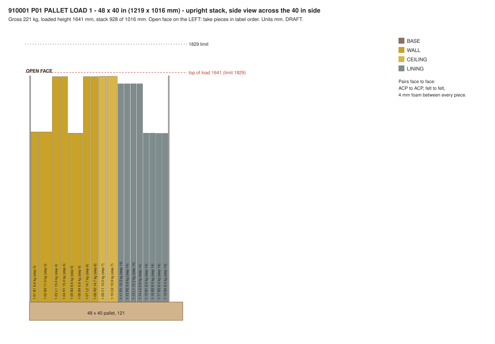
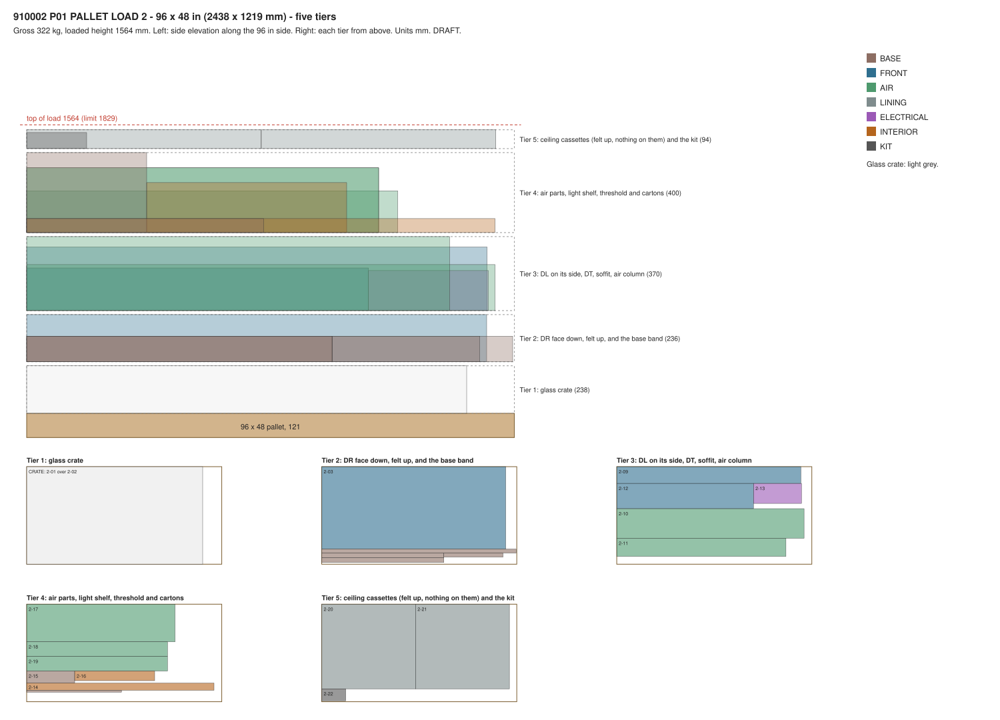

<!-- 910000_P01_PACKAGING-PLAN_PKG.md is generated by v2/07-Packaging/pack.py from v2/07-Packaging/templates/packing-plan.md. Edit the template or the script, never the generated file. -->
# Packing plan: Spaceship (FocusPod v2) on two pallets

| Doc code | Part number | Revision | Status | Date | Owner |
|---|---|---|---|---|---|
| V2-PKG-001 | 910000 PACKAGING · Đóng gói | P01 | DRAFT | 2026-10-31 | Packing and Assembly Engineer |

How the pod ships: every piece, its pallet and its place on it, the order it comes out, how it is protected and labelled, and what each pallet weighs and how tall it stands. The assembly guide that uses these labels is [`100000_P04_POD-ASSEMBLY-GUIDE_INS.md`](../02-Drawings/30-Assembly-Instructions/100000_P04_POD-ASSEMBLY-GUIDE_INS.md).

Every number carries a status (conventions §9): confirmed, source, calculation, assumption, unverified. Lengths are mm and masses kg; inches, pounds and cubic feet appear only as reference beside the metric number (guideline §3.1). Nothing here is ordered or sent to a supplier.

## Result

1. **Two pallets, as D-04 rules.** Pallet 1 is a 48 × 40 in pallet with the wall panels, the wall linings and the floor standing upright: **223 kg gross, 1,641 mm tall.** Pallet 2 is a 96 × 48 in pallet with the glass, the decor blocks, the air parts, the base band, the ceiling linings and the kits: **322 kg gross, 1,439 mm tall.** Both stay under 1829 mm (REQ-SHP-01, REQ-SHP-02); 545 kg gross in all.
2. **Masses are the layout study's P04 roll-up**, 408.5 kg as shipped (`v2/05-Engineering/layout-study/out/parts-decided-P04.csv`, the PM's mass source for every part; its 412.5 kg include the voice kit's reserve, which ships later). `pack.py` reads it line by line and copies no mass. The pallets carry 409.0 kg of pod: the roll-up plus 0.5 kg it doesn't carry (the screen mount and the installation kit; assumptions). The voice cockpit kit ships later and isn't on these pallets (D-11, D-81).
3. **42 labelled pieces.** Each is 20 kg or less except the glass (D-03); the heaviest is FRONT - DECOR BLOCK ASSY - DR (2-03) at 18.9 kg. The door unit (48.6 kg) and the fixed glass (28.7 kg) lie flat in one glass crate at the bottom of pallet 2. Every piece passes the 810 × 2032 doorway rule (REQ-ASM-06).
4. **First out is first fitted.** Pallet 1 comes off its open face in label order, which is fitting order: floor, back and side walls row by row, ceiling halves, then the wall linings. Pallet 2 is unloaded in step 1 of the guide, except the glass crate, which stays closed until step 10; inside the crate the fixed glass lies on top because it goes in first.
5. **Checks: all pass** (section 8): roll-up accounted once, 20 kg, doorway, both footprints and heights, the glass crate, the guide's bolts against the joints register, the time limit, first-out order, labels.
6. **PM rulings this plan follows** (packing group, 2026-10-31): the floor panel is 1219 mm or less including its lap, so nothing overhangs the pallet; the hinge halves that sit in DL ship fitted in DL, so the door travels 1175 mm wide; the door hangs before DT; the intake riser and the supply fan box ship apart and go into DR on site, so DR ships at 20 kg or less.

## 1. Pallets at a glance

| Pallet | Deck mm (in) | Pieces | Net kg | Gross kg (lb) | Loaded height mm (in) | Volume ft3 (reference) | Density lb/ft3 (reference) |
| --- | --- | ---: | ---: | ---: | ---: | ---: | ---: |
| 1: 48 × 40 in, upright stack ([diagram](910001_P01_PALLET-1-48X40_PKG.svg)) | 1219 × 1016 (48 × 40) | 20 | 196.9 | 223 (491) | 1,641 (64.6) | 71.8 | 6.8 |
| 2: 96 × 48 in, five tiers ([diagram](910002_P01_PALLET-2-96X48_PKG.svg)) | 2438 × 1219 (96 × 48) | 22 | 212.1 | 322 (709) | 1,439 (56.6) | 151.1 | 4.7 |
| **Both** |  | 42 | **409.0** | **545** (1,200) |  |  |  |

Pallet tares and pack allowances are the layout study's (S14, S15, `pack_kg_std`, `pack_kg_long`); the glass crate and the tier separators are this plan's assumptions (section 12). Density is given in lb/ft³ because LTL freight class follows from it (REQ-SHP-04); the carrier sets the class, so this plan doesn't guess it. No piece is longer than 96 in, so no overlength charge applies (layout study S19).

## 2. Pallet 1: 48 × 40 in, one upright stack



Every piece stands on edge with its along-size on the 48 in side; the stack runs across the 40 in side. 20 pieces, 808 mm of parts + 19 foam interleaves of 4 mm + 2 edge boards of 10 mm = **904 mm of 1016** across the 40 in side. Tallest piece 1,495 mm up: 121 deck + 1,495 + 25 cap = **1,641 mm loaded**.

| Out | Label | Pos. | Piece | kg | Along × up, mm | Thick mm | Fitted in step |
| ---: | --- | --- | --- | ---: | --- | ---: | ---: |
| 1 | **1-01** | F1 | BASE - FLOOR PANEL ASSY - F1 | 8.2 | 1219 × 1455 | 12 | 3 |
| 2 | **1-02** | F2 | BASE - FLOOR PANEL ASSY - F2 | 8.2 | 1219 × 1455 | 12 | 3 |
| 3 | **1-03** | B1 | WALL - PANEL ASSY - BACK LOWER - B1 | 8.6 | 1200.61 × 1118.61 | 46 | 4 |
| 4 | **1-04** | B2 | WALL - PANEL ASSY - BACK LOWER - B2 | 11.5 | 1200.61 × 1118.61 | 84 | 4 |
| 5 | **1-05** | L1 | WALL - PANEL ASSY - SIDE LOWER - LH | 11.2 | 1142.74 × 1492.74 | 46 | 5 |
| 6 | **1-06** | R1 | WALL - PANEL ASSY - SIDE LOWER - RH | 11.2 | 1142.74 × 1492.74 | 46 | 5 |
| 7 | **1-07** | B3 | WALL - PANEL ASSY - BACK UPPER - B3 | 8.6 | 1200.61 × 1118.61 | 46 | 6 |
| 8 | **1-08** | B4 | WALL - PANEL ASSY - BACK UPPER - B4 | 8.6 | 1200.61 × 1118.61 | 46 | 6 |
| 9 | **1-09** | L2 | WALL - PANEL ASSY - SIDE UPPER - LH | 11.3 | 1142.74 × 1492.74 | 46 | 7 |
| 10 | **1-10** | R2 | WALL - PANEL ASSY - SIDE UPPER - RH | 11.3 | 1142.74 × 1492.74 | 46 | 7 |
| 11 | **1-11** | C1 | CEILING - PANEL ASSY - C1 | 10.0 | 1200.61 × 1495 | 46 | 8 |
| 12 | **1-12** | C2 | CEILING - PANEL ASSY - C2 | 10.3 | 1200.61 × 1495 | 60 | 8 |
| 13 | **1-13** | R1 | LINING - CASSETTE - SIDE LOWER - RH | 10.3 | 1142.74 × 1445 | 34 | 14 |
| 14 | **1-14** | R2 | LINING - CASSETTE - SIDE UPPER - RH | 9.9 | 1092.74 × 1445 | 34 | 14 |
| 15 | **1-15** | L1 | LINING - CASSETTE - SIDE LOWER - LH | 10.3 | 1142.74 × 1445 | 34 | 14 |
| 16 | **1-16** | L2 | LINING - CASSETTE - SIDE UPPER - LH | 9.9 | 1092.74 × 1445 | 34 | 14 |
| 17 | **1-17** | B1 | LINING - CASSETTE - BACK LOWER - B1 | 8.0 | 1166 × 1118.61 | 34 | 14 |
| 18 | **1-18** | B2 | LINING - CASSETTE - BACK LOWER - B2 | 8.0 | 1166 × 1118.61 | 34 | 14 |
| 19 | **1-19** | B3 | LINING - CASSETTE - BACK UPPER - B3 | 8.4 | 1166 × 1116.87 | 34 | 14 |
| 20 | **1-20** | B4 | LINING - CASSETTE - BACK UPPER - B4 | 8.4 | 1166 × 1116.87 | 34 | 14 |

How to load it (factory):

1. Deck: a 10 mm edge board standing at the back edge, then the pieces in **reverse** label order, the highest number first and 1-01 last, so 1-01 ends up at the open face.
2. Pairs face to face: each pair of outer panels meets ACP to ACP (B1 with B2, L1 with R1, B3 with B4, L2 with R2, C1 with C2), and each pair of cassettes felt to felt (R1 with R2, L1 with L2, B1 with B2, B3 with B4), with a clean polyethylene sheet between the felts. A 4 mm foam interleaf goes between every two pieces.
3. Outer panels stand on a frame edge, never on an ACP edge: on the back stile for L1, L2, R1, R2 (40 × 40, D-63), on a side member for the back panels and the ceiling halves. Cassettes stand on a tray return.
4. A 10 mm edge board at the open face, corner guards on all eight top corners of the stack, a 25 mm cap board, two horizontal and two vertical straps over edge protectors, and three layers of stretch film. "OPEN THIS FACE FIRST" arrows on the film over 1-01.

On site, keep the two horizontal straps on and take one piece at a time off the open face. When four pieces are left, lay them flat on the floor protection.

## 3. Pallet 2: 96 × 48 in, five tiers



121 deck + 238 (tier 1) + 205 (tier 2) + 360 (tier 3) + 320 (tier 4) + 90 (tier 5) + 4 separators of 20 + 25 cap = **1,439 mm loaded** of 1829. Widest tier 1,219 mm of 1219; longest lane 2,420 mm of 2438.

| Tier | Lane mm | Label | Piece | kg | Along × across × up, mm | Fitted in step |
| --- | ---: | --- | --- | ---: | --- | --- |
| Tier 1: glass crate | crate | - | GLASS CRATE 911001 with 2-01, 2-02 | 113.3 | 2200 × 1219 × 238 | 10, 11 |
| Tier 2: DR and the base band | 1016 | **2-03** | FRONT - DECOR BLOCK ASSY - DR | 18.9 | 2290 × 1016 × 205 | 10 |
| Tier 2: DR and the base band | 50 | **2-04** | BASE - BAND ASSY - BACK | 3.2 | 2420 × 40 × 110 | 2 |
| Tier 2: DR and the base band | 50 | **2-05** | BASE - BAND ASSY - SIDE - LH | 2.0 | 1517 × 40 × 110 | 2 |
| Tier 2: DR and the base band | 50 | **2-07** | BASE - BAND ASSY - FRONT - RH - UNDER THE FIXED GLASS | 1.1 | 729 × 40 × 110 | 2 |
| Tier 2: DR and the base band | 50 | **2-06** | BASE - BAND ASSY - SIDE - RH | 2.0 | 1517 × 40 × 110 | 2 |
| Tier 2: DR and the base band | 40 | **2-08** | BASE - DOOR THRESHOLD - 13 MM | 1.2 | 1175 × 13 × 60 | 3 |
| Tier 3: DL, soffit, air column, DT | 278 | **2-09** | FRONT - DECOR BLOCK ASSY - DL | 12.3 | 2290 × 278 × 205 | 9 |
| Tier 3: DL, soffit, air column, DT | 360 | **2-10** | AIR - SOFFIT WITH THE EXHAUST FAN BOX AND 2 FANS | 15.4 | 2332 × 360 × 220 | 17 |
| Tier 3: DL, soffit, air column, DT | 217 | **2-11** | AIR - AIR COLUMN | 8.1 | 2105 × 217 × 360 | 16 |
| Tier 3: DL, soffit, air column, DT | 280 | **2-12** | FRONT - DECOR BLOCK ASSY - DT | 7.9 | 1697 × 280 × 205 | 12 |
| Tier 3: DL, soffit, air column, DT | 280 | **2-13** | ELECTRICAL - KIT - HARNESS, CORD SET, HUB ZONE, LIGHTS | 2.3 | 600 × 250 × 200 | 13 |
| Tier 3: DL, soffit, air column, DT | 80 | **2-14** | INTERIOR - LIGHT SHELF ASSY | 1.6 | 2332 × 80 × 60 | 19 |
| Tier 4: air parts and cartons | 460 | **2-17** | AIR - INTAKE RISER WITH THE SUPPLY FAN BOX AND 2 FANS | 12.9 | 1845 × 460 × 155 | 15 |
| Tier 4: air parts and cartons | 400 | **2-15** | BASE - SMALL PARTS CARTON | 2.0 | 600 × 400 × 150 | 2 |
| Tier 4: air parts and cartons | 400 | **2-16** | INTERIOR - WORK WALL LEDGE ASSY | 1.9 | 1000 × 250 × 120 | 22 |
| Tier 4: air parts and cartons | 173 | **2-18** | AIR - CARTRIDGE - SUPPLY | 10.6 | 1750 × 173 × 314 | 16 |
| Tier 4: air parts and cartons | 173 | **2-19** | AIR - CARTRIDGE - EXHAUST | 10.6 | 1750 × 173 × 314 | 17 |
| Tier 5: ceiling cassettes (felt up, nothing on them) and the kit | 1048 | **2-20** | LINING - CASSETTE - CEILING - COMMON | 9.5 | 1163 × 1048 × 74 | 18 |
| Tier 5: ceiling cassettes (felt up, nothing on them) and the kit | 1048 | **2-21** | LINING - CASSETTE - CEILING - COMMON | 9.5 | 1163 × 1048 × 74 | 18 |
| Tier 5: ceiling cassettes (felt up, nothing on them) and the kit | 150 | **2-22** | POD - INSTALLATION KIT (OPEN FIRST) | 0.5 | 300 × 150 × 80 | 1 |

**Glass crate (911001), tier 1.** Outside 2200 x 1219 x 238 mm; inside 2,110 x 1,185 x 208 mm: the door layer 164 mm (door on 75 mm foam blocks so its lower pull hangs free), a 12 mm separator, then the fixed glass layer 32 mm on top, because it is fitted first (step 10). Door 2089 x 1175 mm and fixed glass 2033 x 1031 mm each keep 5 mm of edge foam all round. Both panes lie on foam pads with their setting-block edges to the same end, under a slatted lid; nothing in the crate presses on a glass face. A pair of padded A-frame glass rests (911002) travels flat in the crate.

**Tier separators (911003).** Timber battens carried on posts at the corners and sides, so no tier rests on a decor skin, a felt face or the crate lid's span: the crate lid takes tier 2's load only over its frame.

How to load it (factory): crate first, then tier by tier, each lane against the deck's long edge it is drawn on. Decor blocks lie on their back plates, faceted skin up, with corner guards on every facet edge. Cartridges stand on edge between foam blocks and are strapped to the separator. The ceiling cassettes lie last, tray side down on a 10 mm foam sheet, felt up under a clean polyethylene sheet, with nothing on them; the OPEN FIRST kit (109000) rides beside them, under the cap board. Straps over edge protectors and three layers of film over the whole load.

## 4. Protection

| What | Protection | Why |
|---|---|---|
| ACP faces (walls, decor) | Protective film on the faces that show only (the 8 wall skins and the 3 decor blocks; none on the roof skins), each panel with a quick-release tab (D-87); it stays on until the final check (guide step 21). Corner guards on every corner; 4 mm foam between pieces | The ACP is the look (D-01); scratches can't be repaired on site |
| Felt faces (every lining cassette, the air column and soffit faces) | Felt to felt with a clean PE sheet between; no tape, no label and no load on felt; nothing stacked on the ceiling cassettes | Felt marks and dents; adhesive tears it |
| Lining trays and their 12 mm lips | Stand on a return, never on a lip; foam between trays | The lips hold the felt (D-69) |
| Frame edges with spigots and captive bolts | The bolts travel pulled back, tips flush, held by their grommets (joints register 2.2); edge protectors under every strap | A bent spigot or a pushed-in bolt stops the part locating on site |
| Black anodised base band and threshold | Foam sleeve on each piece; corners in edge guards | Anodise can't be touched up (D-67) |
| Decor blocks DL, DR, DT | On their back plates, skins up, corner guards on facet edges, foam wrap, separators above | Faceted skins are the iconic front (D-01) |
| Glass: door unit and fixed glass | Crate with 5 mm edge foam all round, foam pads above and below, setting-block edges marked; film on both faces with quick-release tabs (D-87), on until the final check; no tape or label on the glass itself | Laminated toughened glass breaks at its edges; the door's hinge halves and pull need free space |
| Air cartridges, the riser with its fan box, the soffit with its fan box | End caps on the cartridges; each fan box bagged inside its part, its plug-in connector taped to the box (not to the fans); the riser unit in foam | Keeps fill, fans and connectors clean and dry |
| The power unit in B2 (ELECTRICAL) | A foam block over the unit's black face, which stands 38 mm proud of B2's frame; B2 stands with that face toward L1's frame side, so the block takes the gap | The unit ships wired and tested; its face plate is visible aluminium (D-67) |
| Kits and cartons | Cartons with the contents list on the side | One place for small parts |
| The whole load | Straps over edge protectors, cap board, three layers of stretch film, "DO NOT STACK" on both pallets | Fork and stacking damage |

## 5. Labels

**Part labels (911010).** One 100 × 150 mm label (4 × 6 in, reference) on every piece, so every part carries its part number and position code (REQ-ASM-08). It shows, largest first:

1. The label number (for example **1-07**) and the position code (**L1**);
2. The part number, or "TBD (owner)" until the master BOM gives one;
3. The name in English and Vietnamese, as in the table below;
4. The guide step that fits it, the mass in kg, and "1 PERSON" or "2 PEOPLE";
5. Warnings where they apply: "GLASS: 2 PEOPLE, 2 SUCTION LIFTERS", "FELT FACE: NO TAPE", "THIS EDGE DOWN".

Where it goes: on a face that is hidden once assembled, so it stays as a record: the frame's room-side face near the bottom-left corner for outer panels, the tray's back for cassettes, the back plate's inside for decor blocks, the band's inside face, the carton's side. Glass is labelled on its protective film, never on the glass. A copy of each label goes on the wrap over the piece. The installation kit carries a label map: a plan of the pod with every label number in its place.

**Pallet labels (911011).** Two per pallet, on adjacent sides: "PALLET 1 OF 2" or "2 OF 2", the gross mass in kg (lb), the deck size and loaded height in mm (in), "DO NOT STACK", "OPEN THIS FACE FIRST" (pallet 1) or "FRAGILE: GLASS, THIS WAY UP" (pallet 2), fork entry marks, and a pouch with this plan's packing list for that pallet.

| Label | Part number | Pos. | Name on the label | kg | People to lift | Step |
| --- | --- | --- | --- | ---: | ---: | ---: |
| **1-01** | 110401 | F1 | BASE - FLOOR PANEL ASSY - F1 | 8.2 | 1 | 3 |
| **1-02** | TBD (BASE) | F2 | BASE - FLOOR PANEL ASSY - F2 | 8.2 | 1 | 3 |
| **1-03** | 210201 | B1 | WALL - PANEL ASSY - BACK LOWER - B1 | 8.6 | 1 | 4 |
| **1-04** | 210202 | B2 | WALL - PANEL ASSY - BACK LOWER - B2 | 11.5 | 1 | 4 |
| **1-05** | 210101 | L1 | WALL - PANEL ASSY - SIDE LOWER - LH | 11.2 | 1 | 5 |
| **1-06** | 210102 | R1 | WALL - PANEL ASSY - SIDE LOWER - RH | 11.2 | 1 | 5 |
| **1-07** | TBD (WALL) | B3 | WALL - PANEL ASSY - BACK UPPER - B3 | 8.6 | 1 | 6 |
| **1-08** | TBD (WALL) | B4 | WALL - PANEL ASSY - BACK UPPER - B4 | 8.6 | 1 | 6 |
| **1-09** | 210103 | L2 | WALL - PANEL ASSY - SIDE UPPER - LH | 11.3 | 1 | 7 |
| **1-10** | 210104 | R2 | WALL - PANEL ASSY - SIDE UPPER - RH | 11.3 | 1 | 7 |
| **1-11** | 410101 | C1 | CEILING - PANEL ASSY - C1 | 10.0 | 1 | 8 |
| **1-12** | 410102 | C2 | CEILING - PANEL ASSY - C2 | 10.3 | 1 | 8 |
| **1-13** | 510102 | R1 | LINING - CASSETTE - SIDE LOWER - RH | 10.3 | 1 | 14 |
| **1-14** | 510104 | R2 | LINING - CASSETTE - SIDE UPPER - RH | 9.9 | 1 | 14 |
| **1-15** | 510101 | L1 | LINING - CASSETTE - SIDE LOWER - LH | 10.3 | 1 | 14 |
| **1-16** | 510103 | L2 | LINING - CASSETTE - SIDE UPPER - LH | 9.9 | 1 | 14 |
| **1-17** | 510201 | B1 | LINING - CASSETTE - BACK LOWER - B1 | 8.0 | 1 | 14 |
| **1-18** | 510202 | B2 | LINING - CASSETTE - BACK LOWER - B2 | 8.0 | 1 | 14 |
| **1-19** | TBD (WALL) | B3 | LINING - CASSETTE - BACK UPPER - B3 | 8.4 | 1 | 14 |
| **1-20** | TBD (WALL) | B4 | LINING - CASSETTE - BACK UPPER - B4 | 8.4 | 1 | 14 |
| **2-01** | 360002 | - | FRONT - FIXED GLASS UNIT | 28.7 | 2 | 10 |
| **2-02** | 360001 | - | FRONT - DOOR UNIT | 48.6 | 2 | 11 |
| **2-03** | 350003 | DR | FRONT - DECOR BLOCK ASSY - DR | 18.9 | 2 | 10 |
| **2-04** | 110103 | - | BASE - BAND ASSY - BACK | 3.2 | 2 | 2 |
| **2-05** | 110101 | - | BASE - BAND ASSY - SIDE - LH | 2.0 | 1 | 2 |
| **2-06** | TBD (BASE) | - | BASE - BAND ASSY - SIDE - RH | 2.0 | 1 | 2 |
| **2-07** | TBD (BASE) | - | BASE - BAND ASSY - FRONT - RH - UNDER THE FIXED GLASS | 1.1 | 1 | 2 |
| **2-08** | TBD (BASE) | - | BASE - DOOR THRESHOLD - 13 MM | 1.2 | 1 | 3 |
| **2-09** | 350001 | DL | FRONT - DECOR BLOCK ASSY - DL | 12.3 | 2 | 9 |
| **2-10** | TBD (AIR) | - | AIR - SOFFIT WITH THE EXHAUST FAN BOX AND 2 FANS | 15.4 | 2 | 17 |
| **2-11** | 610101 | - | AIR - AIR COLUMN | 8.1 | 2 | 16 |
| **2-12** | 350002 | DT | FRONT - DECOR BLOCK ASSY - DT | 7.9 | 2 | 12 |
| **2-13** | TBD (ELECTRICAL) | - | ELECTRICAL - KIT - HARNESS, CORD SET, HUB ZONE, LIGHTS | 2.3 | 1 | 13 |
| **2-14** | 810201 | - | INTERIOR - LIGHT SHELF ASSY | 1.6 | 2 | 19 |
| **2-15** | TBD (BASE) | - | BASE - SMALL PARTS CARTON | 2.0 | 1 | 2 |
| **2-16** | 810101 | - | INTERIOR - WORK WALL LEDGE ASSY | 1.9 | 1 | 22 |
| **2-17** | TBD (AIR) | - | AIR - INTAKE RISER WITH THE SUPPLY FAN BOX AND 2 FANS | 12.9 | 2 | 15 |
| **2-18** | TBD (AIR) | - | AIR - CARTRIDGE - SUPPLY | 10.6 | 2 | 16 |
| **2-19** | TBD (AIR) | - | AIR - CARTRIDGE - EXHAUST | 10.6 | 2 | 17 |
| **2-20** | 510301 | C1 | LINING - CASSETTE - CEILING - COMMON | 9.5 | 1 | 18 |
| **2-21** | 510301 | C2 | LINING - CASSETTE - CEILING - COMMON | 9.5 | 1 | 18 |
| **2-22** | 109000 | - | POD - INSTALLATION KIT (OPEN FIRST) | 0.5 | 1 | 1 |

## 6. Packing lists

### Pallet 1: 48 × 40 in

| Label | Part number | Piece | Vietnamese | Pos. | kg | Status | Size mm | Step |
| --- | --- | --- | --- | --- | ---: | --- | --- | ---: |
| **1-01** | 110401 | BASE - FLOOR PANEL ASSY - F1 | Tấm sàn F1 (cụm dán) | F1 | 8.18 | calculation (CAD); confirmed (9 mm, poplar core); calculation (CAD) | 1455 × 1219 × 12 | 3 |
| **1-02** | TBD (BASE) | BASE - FLOOR PANEL ASSY - F2 | Tấm sàn F2 (cụm dán) | F2 | 8.18 | calculation (CAD); confirmed (9 mm, poplar core); calculation (CAD) | 1455 × 1219 × 12 | 3 |
| **1-03** | 210201 | WALL - PANEL ASSY - BACK LOWER - B1 | Vách hậu - cụm tấm dưới trái | B1 | 8.64 | calculation (part CAD); fill provisional | 1200.61 × 1118.61 × 46 | 4 |
| **1-04** | 210202 | WALL - PANEL ASSY - BACK LOWER - B2 | Vách hậu - cụm tấm dưới phải | B2 | 11.53 | calculation (CAD); calculation (part CAD); fill provisional | 1200.61 × 1118.61 × 84 | 4 |
| **1-05** | 210101 | WALL - PANEL ASSY - SIDE LOWER - LH | Vách trái - cụm tấm dưới | L1 | 11.16 | calculation (CAD); fill provisional | 1492.74 × 1142.74 × 46 | 5 |
| **1-06** | 210102 | WALL - PANEL ASSY - SIDE LOWER - RH | Vách phải - cụm tấm dưới | R1 | 11.16 | calculation (CAD); fill provisional | 1492.74 × 1142.74 × 46 | 5 |
| **1-07** | TBD (WALL) | WALL - PANEL ASSY - BACK UPPER - B3 | Vách hậu - cụm tấm trên trái | B3 | 8.64 | calculation (part CAD); fill provisional | 1200.61 × 1118.61 × 46 | 6 |
| **1-08** | TBD (WALL) | WALL - PANEL ASSY - BACK UPPER - B4 | Vách hậu - cụm tấm trên phải | B4 | 8.64 | calculation (part CAD); fill provisional | 1200.61 × 1118.61 × 46 | 6 |
| **1-09** | 210103 | WALL - PANEL ASSY - SIDE UPPER - LH | Vách trái - cụm tấm trên | L2 | 11.29 | calculation (CAD); fill provisional | 1492.74 × 1142.74 × 46 | 7 |
| **1-10** | 210104 | WALL - PANEL ASSY - SIDE UPPER - RH | Vách phải - cụm tấm trên | R2 | 11.29 | calculation (CAD); fill provisional | 1492.74 × 1142.74 × 46 | 7 |
| **1-11** | 410101 | CEILING - PANEL ASSY - C1 | Trần - tấm trái (cụm) | C1 | 10.05 | calculation (CAD) | 1495 × 1200.61 × 46 | 8 |
| **1-12** | 410102 | CEILING - PANEL ASSY - C2 | Trần - tấm phải (cụm) | C2 | 10.31 | calculation (CAD) | 1495 × 1200.61 × 60 | 8 |
| **1-13** | 510102 | LINING - CASSETTE - SIDE LOWER - RH | Cassette lót vách phải dưới (khay thép + tấm tiêu âm) | R1 | 10.34 | calculation (CAD) | 1445 × 1142.74 × 34 | 14 |
| **1-14** | 510104 | LINING - CASSETTE - SIDE UPPER - RH | Cassette lót vách phải trên (khay thép + tấm tiêu âm) | R2 | 9.91 | calculation (CAD) | 1445 × 1092.74 × 34 | 14 |
| **1-15** | 510101 | LINING - CASSETTE - SIDE LOWER - LH | Cassette lót vách trái dưới (khay thép + tấm tiêu âm) | L1 | 10.34 | calculation (CAD) | 1445 × 1142.74 × 34 | 14 |
| **1-16** | 510103 | LINING - CASSETTE - SIDE UPPER - LH | Cassette lót vách trái trên (khay thép + tấm tiêu âm) | L2 | 9.91 | calculation (CAD) | 1445 × 1092.74 × 34 | 14 |
| **1-17** | 510201 | LINING - CASSETTE - BACK LOWER - B1 | Cassette lót vách hậu dưới trái (khay thép + tấm tiêu âm) | B1 | 8.01 | calculation (CAD) | 1166 × 1118.61 × 34 | 14 |
| **1-18** | 510202 | LINING - CASSETTE - BACK LOWER - B2 | Cassette lót vách hậu dưới phải (khay thép + tấm tiêu âm) | B2 | 8.01 | calculation (CAD) | 1166 × 1118.61 × 34 | 14 |
| **1-19** | TBD (WALL) | LINING - CASSETTE - BACK UPPER - B3 | Cassette tiêu âm - vách hậu trên trái | B3 | 8.40 | calculation; lips confirmed | 1166 × 1116.87 × 34 | 14 |
| **1-20** | TBD (WALL) | LINING - CASSETTE - BACK UPPER - B4 | Cassette tiêu âm - vách hậu trên phải | B4 | 8.40 | calculation; lips confirmed | 1166 × 1116.87 × 34 | 14 |
| - | - | 40 × 40 corner edge tubes in L2, R2, C1, C2 (D-63) |  | - | 0.01 | calculation | inside the pieces | - |
| - | - | Bond beyond L1 and R1 (D-71) |  | - | 0.05 | calculation | inside the pieces | - |
| - | - | Captive bolts, washers, rivnuts, stop washers, spigots, gaskets, fitted in the panels |  | - | 3.14 | calculation (part CAD); cleats assumption | inside the pieces | - |
| - | - | Wall cassette clips: 32 of the 44 named clips, on the wall panels and cassettes |  | - | 1.28 | assumption | inside the pieces | - |
| - | 918001 (PROPOSED) | PACKAGING - PALLET - 48 X 40 IN, NEW WOOD, 4-WAY (GMA) |  | - | 20.00 | source | - | - |
| - | 918010 (PROPOSED) | PACKAGING - PROTECTION SET, 48 X 40: edge boards, corner guards, foam interleaf, PE sheets, cap board, straps, film |  | - | 6.00 | assumption | - | - |
|  |  | **Gross** |  |  | **222.9** |  |  |  |

### Pallet 2: 96 × 48 in

| Label | Part number | Piece | Vietnamese | Pos. | kg | Status | Size mm | Step |
| --- | --- | --- | --- | --- | ---: | --- | --- | ---: |
| **2-01** | 360002 | FRONT - FIXED GLASS UNIT | Cụm vách kính cố định | - | 28.74 | calculation (CAD); magnetic seal HOLD | 2033 × 1031 × 12 | 10 |
| **2-02** | 360001 | FRONT - DOOR UNIT | Cụm cửa kính | - | 48.59 | calculation (CAD); hinges and pull HOLD | 2089 × 1175 × 149 | 11 |
| **2-03** | 350003 | FRONT - DECOR BLOCK ASSY - DR | Khối trang trí phải (cụm) | DR | 18.86 | calculation (CAD); calculation (CAD); magnetic seal HOLD | 2290 × 1016 × 205 | 10 |
| **2-04** | 110103 | BASE - BAND ASSY - BACK | Viền chân nhôm - cạnh sau (cụm) | - | 3.17 | assumption (CAD, HOLD); calculation (CAD); calculation (CAD); confirmed (1.5 mm) | 2420 × 110 × 40 | 2 |
| **2-05** | 110101 | BASE - BAND ASSY - SIDE - LH | Viền chân nhôm - cạnh trái (cụm) | - | 2.00 | assumption (CAD, HOLD); calculation (CAD); calculation (CAD); confirmed (1.5 mm) | 1517 × 110 × 40 | 2 |
| **2-06** | TBD (BASE) | BASE - BAND ASSY - SIDE - RH | Viền chân nhôm - cạnh phải (cụm) | - | 2.00 | assumption (CAD, HOLD); calculation (CAD); calculation (CAD); confirmed (1.5 mm) | 1517 × 110 × 40 | 2 |
| **2-07** | TBD (BASE) | BASE - BAND ASSY - FRONT - RH - UNDER THE FIXED GLASS | Viền chân nhôm - trước phải, dưới kính | - | 1.12 | assumption (CAD, HOLD); calculation (CAD); calculation (CAD); magnetic seal HOLD; calculation; confirmed (1.5 mm) | 729 × 110 × 40 | 2 |
| **2-08** | TBD (BASE) | BASE - DOOR THRESHOLD - 13 MM | Ngưỡng cửa thấp 13 mm | - | 1.20 | assumption | 1175 × 60 × 13 | 3 |
| **2-09** | 350001 | FRONT - DECOR BLOCK ASSY - DL | Khối trang trí trái (cụm) | DL | 12.30 | calculation (CAD) | 2290 × 278 × 205 | 9 |
| **2-10** | TBD (AIR) | AIR - SOFFIT WITH THE EXHAUST FAN BOX AND 2 FANS | Hộp gió trên cửa + hộp quạt thải | - | 15.39 | assumption; calculation (CAD at 2 mm, scaled to D-124's 3 mm); calculation (CAD); hinges, latches and studs HOLD; fill provisional | 2332 × 360 × 220 | 17 |
| **2-11** | 610101 | AIR - AIR COLUMN | Cột gió (cụm) | - | 8.15 | calculation (CAD); fill provisional | 2105 × 360 × 217 | 16 |
| **2-12** | 350002 | FRONT - DECOR BLOCK ASSY - DT | Khối trang trí trên (cụm) | DT | 7.91 | calculation (CAD); calculation (CAD); magnetic seal HOLD | 1697 × 280 × 205 | 12 |
| **2-13** | TBD (ELECTRICAL) | ELECTRICAL - KIT - HARNESS, CORD SET, HUB ZONE, LIGHTS | Bộ điện: dây, dây nguồn, hub, đèn | - | 2.28 | calculation (CAD) | 600 × 250 × 200 | 13 |
| **2-14** | 810201 | INTERIOR - LIGHT SHELF ASSY | Kệ đèn hắt (cụm) | - | 1.58 | calculation (CAD) | 2332 × 80 × 60 | 19 |
| **2-15** | TBD (BASE) | BASE - SMALL PARTS CARTON | Thùng phụ kiện đế | - | 1.97 | calculation (CAD); calculation; confirmed (1.5 mm) | 600 × 400 × 150 | 2 |
| **2-16** | 810101 | INTERIOR - WORK WALL LEDGE ASSY | Bàn tựa vách làm việc (cụm) | - | 1.90 | calculation (CAD); brackets and screen rail HOLD | 1000 × 250 × 120 | 22 |
| **2-17** | TBD (AIR) | AIR - INTAKE RISER WITH THE SUPPLY FAN BOX AND 2 FANS | Ống hút gió đứng + hộp quạt cấp | - | 12.95 | assumption; calculation (CAD at 2 mm, scaled to D-124's 3 mm); transitions HOLD at their sized masses; calculation (CAD); foot and mesh assumption | 1845 × 460 × 155 | 15 |
| **2-18** | TBD (AIR) | AIR - CARTRIDGE - SUPPLY | Ống tiêu âm cấp gió | - | 10.55 | calculation (CAD) | 1750 × 314 × 173 | 16 |
| **2-19** | TBD (AIR) | AIR - CARTRIDGE - EXHAUST | Ống tiêu âm thải gió | - | 10.55 | calculation (CAD) | 1750 × 314 × 173 | 17 |
| **2-20** | 510301 | LINING - CASSETTE - CEILING - COMMON | Cassette trần (dùng chung trái/phải) | C1 | 9.46 | calculation (CAD); fill provisional | 1163 × 1048 × 74 | 18 |
| **2-21** | 510301 | LINING - CASSETTE - CEILING - COMMON | Cassette trần (dùng chung trái/phải) | C2 | 9.46 | calculation (CAD); fill provisional | 1163 × 1048 × 74 | 18 |
| **2-22** | 109000 | POD - INSTALLATION KIT (OPEN FIRST) | Bộ phụ kiện lắp (mở trước) | - | 0.50 | assumption | 300 × 150 × 80 | 1 |
| - | - | Base seal and cable grommets, fitted on the band and the panels (the door edge seals are in FRONT's parts) |  | - | 0.60 | source | inside the pieces | - |
| - | - | Ceiling clips and catches: 12 clips and 4 lanyards, with the ceiling cassettes |  | - | 0.88 | assumption | inside the pieces | - |
| - | 918002 (PROPOSED) | PACKAGING - PALLET - 96 X 48 IN, NEW WOOD, 4-WAY |  | - | 48.50 | source | - | - |
| - | 911001 (PROPOSED) | PACKAGING - GLASS CRATE |  | - | 30.00 | assumption | - | - |
| - | 911002 (PROPOSED) | PACKAGING - GLASS REST, A-FRAME, PADDED (PAIR) |  | - | 6.00 | assumption | - | - |
| - | 911003 (PROPOSED) | PACKAGING - TIER SEPARATOR (BATTENS ON POSTS) |  | - | 16.00 | assumption | - | - |
| - | 918011 (PROPOSED) | PACKAGING - PROTECTION SET, 96 X 48: corner guards, foam, PE sheets, cap board, straps, film |  | - | 9.00 | assumption | - | - |
|  |  | **Gross** |  |  | **321.6** |  |  |  |

The same list, one row per piece with its mass source and size source, is [`910000_P01_PACKING-LIST_BOM.csv`](910000_P01_PACKING-LIST_BOM.csv).

## 7. Every roll-up line, and the pieces that carry it

| Group | Roll-up line | Qty | kg | Status | Carried by |
| --- | --- | ---: | ---: | --- | --- |
| WALL | L1 and R1, lower side outer panels | 2 | 22.33 | calculation (CAD); fill provisional | 1-05, 1-06 |
| WALL | L2 and R2, upper side outer panels | 2 | 22.59 | calculation (CAD); fill provisional | 1-09, 1-10 |
| WALL | B1 to B4, back outer panels | 4 | 34.56 | calculation (part CAD); fill provisional | 1-03, 1-04, 1-07, 1-08 |
| WALL | 40 × 40 corner edge tubes beyond the panels' own | 1 | 0.01 | calculation | A-1 |
| WALL | Bond over this study's 0.25 kg/m2, beyond the panels in CAD | 1 | 0.05 | calculation | A-2 |
| LINING | Wall cassette, side, lower, with 12 mm lips, no clip rails | 2 | 20.68 | calculation (CAD) | 1-13, 1-15 |
| LINING | Wall cassette, side, upper, with 12 mm lips, no clip rails | 2 | 19.82 | calculation (CAD) | 1-14, 1-16 |
| LINING | Wall cassette, back, lower, with 12 mm lips, no clip rails | 2 | 16.03 | calculation (CAD) | 1-17, 1-18 |
| LINING | Wall cassette, back, upper, with 12 mm lips, no clip rails | 2 | 16.80 | calculation; lips confirmed | 1-19, 1-20 |
| CEILING | Ceiling outer panels C1 and C2, with their bond line | 2 | 20.09 | calculation (CAD) | 1-11, 1-12 |
| LINING | Ceiling cassettes, one part for both halves | 2 | 18.91 | calculation (CAD); fill provisional | 2-20, 2-21 |
| LINING | Named clips and catches: 44 clips and 4 catch lanyards | 1 | 2.16 | assumption | A-5 × 0.592593, A-6 × 0.407407 |
| BASE | Base band piece 100x40 - back, 1.5 mm wall | 1 | 2.68 | calculation (CAD); confirmed (1.5 mm) | 2-04 |
| BASE | Base band piece 100x40 - side, 1.5 mm wall | 2 | 3.34 | calculation (CAD); confirmed (1.5 mm) | 2-05, 2-06 |
| BASE | Base band piece 100x40 - front-l, 1.5 mm wall | 1 | 0.33 | calculation; confirmed (1.5 mm) | 2-15 |
| BASE | Base band piece 100x40 - front-r, 1.5 mm wall | 1 | 1.17 | calculation; confirmed (1.5 mm) | 2-07 × 0.663, 2-15 × 0.337 |
| BASE | Corner key | 6 | 1.24 | calculation (CAD) | 2-15 × 6 |
| BASE | Levelling glide (hex from above) | 8 | 1.20 | assumption (CAD, HOLD) | 2-04 × 3, 2-05 × 2, 2-06 × 2, 2-07 |
| BASE | Door threshold, low | 1 | 1.20 | assumption | 2-08 |
| BASE | Glide load blocks: BASE's glide doublers, one at each glide | 1 | 0.12 | calculation (CAD) | 2-04 × 0.375, 2-05 × 0.25, 2-06 × 0.25, 2-07 × 0.125 |
| BASE | Floor panels, 9 mm poplar-core plywood with a hard face veneer | 2 | 14.24 | confirmed (9 mm, poplar core); calculation (CAD) | 1-01, 1-02 |
| BASE | Floor mat, 3 mm firm closed-cell foam | 1 | 2.12 | calculation (CAD) | 1-01 × 0.5, 1-02 × 0.5 |
| FRONT | Decor block - left | 1 | 12.30 | calculation (CAD) | 2-09 |
| FRONT | Decor block - right | 1 | 18.32 | calculation (CAD) | 2-03 |
| FRONT | Decor block - top | 1 | 7.84 | calculation (CAD) | 2-12 |
| FRONT | Door unit 360001: 4+4 leaf, hollow kick strip, drop seal, hinges, strike, magnetic seal, pull | 1 | 48.59 | calculation (CAD); hinges and pull HOLD | 2-02 |
| FRONT | Fixed glass unit 360002: 4+4 pane, U-profile, U-seal and magnetic seal half | 1 | 29.54 | calculation (CAD); magnetic seal HOLD | 2-01 × 0.973022, 2-03 × 0.018405, 2-07 × 0.00609411, 2-12 × 0.00247854 |
| AIR | Supply cartridge, in the air column | 1 | 10.55 | calculation (CAD) | 2-18 |
| AIR | Exhaust cartridge, in the soffit | 1 | 10.55 | calculation (CAD) | 2-19 |
| AIR | Air column 610101: felt-covered faces, corner angles, foot and plenum plates, fill, kick grille | 1 | 8.15 | calculation (CAD); fill provisional | 2-11 |
| AIR | Soffit 610201: underside sections, front face, rails, end and door-side plates, fill, exhaust grille, hangers, hinges, latches, lock screws | 1 | 11.69 | calculation (CAD); hinges, latches and studs HOLD; fill provisional | 2-10 |
| AIR | Supply fan box 610401 with its two transitions, in the right block; ships loose, fitted on site | 1 | 5.71 | calculation (CAD at 2 mm, scaled to D-124's 3 mm); transitions HOLD at their sized masses | 2-17 |
| AIR | Exhaust fan box 610402 and roof sleeve 611601, in the soffit | 1 | 3.10 | calculation (CAD at 2 mm, scaled to D-124's 3 mm) | 2-10 |
| AIR | Intake riser 611501, in the right block; ships loose, fitted on site | 1 | 6.64 | calculation (CAD); foot and mesh assumption | 2-17 |
| AIR | Roof slot grille 611602 | 1 | 0.26 | calculation (CAD) | 1-12 |
| AIR | Four 12 V fans | 1 | 1.20 | assumption | 2-10 × 0.5, 2-17 × 0.5 |
| BASE | Base seal and cable grommets | 1 | 0.60 | source | A-4 |
| ELECTRICAL | Switches and harness, power unit, cord set, hub zone and lights (ELECTRICAL) | 1 | 5.17 | calculation (CAD) | 1-04 × 0.558824, 2-13 × 0.441176 |
| INTERIOR | Light shelf along the side and back wall tops (its LED strip is in ELECTRICAL's line) | 1 | 1.58 | calculation (CAD) | 2-14 |
| INTERIOR | Work-wall ledge, 1000 mm, with the screen rail | 1 | 1.90 | calculation (CAD); brackets and screen rail HOLD | 2-16 |
| WALL | M6 bolts, rivnuts, washers, retainers, joint gaskets and seals, spigots and stop washers, frame cleats | 1 | 3.14 | calculation (part CAD); cleats assumption | A-3 |
| LATER | Voice cockpit kit reserve, outside the 420 kg cap | 1 | 4.00 | assumption | L-1 |

A share like "x 0.5" means the piece carries that part of the roll-up line: the two floor mats share one line; the front-right band line is split between its two pieces by length, 729 and 371 of 1100 mm (calculation); the four fans ride two in each fan box; the named clips are split by count, 32 wall clips on pallet 1 and 12 ceiling clips with the 4 catch lanyards on pallet 2 (calculation at the roll-up's 40 g a clip and 100 g a lanyard).

## 8. Checks

`python3 v2/07-Packaging/pack.py --check` runs these on every build and fails if any output is stale.

| Check | What | Result | Pass |
| --- | --- | --- | --- |
| K1 | Every roll-up line is shipped exactly once, or marked as shipping later | 42 lines, 412.5 kg; 0 lines miscounted, 0 unknown | yes |
| K2 | Every piece 20 kg or less except the glass (D-03) | heaviest non-glass piece 2-03 FRONT - DECOR BLOCK ASSY - DR 18.9 kg; over 20 kg: 0 | yes |
| K3 | Every piece passes the 810 × 2032 doorway rule (REQ-ASM-06) | 42 pieces, 0 fail | yes |
| K4 | Pallet 1: each upright piece within 1219.2 along and the height limit; stack within 1016 | stack 904 mm of 1016; loaded height 1641 mm of 1829; misfits none | yes |
| K5 | Pallet 2: lanes within 1219 across and 2438 along, parts within their tier, loaded height 1829 or less | loaded height 1439 mm; widest tier 1219 mm; longest lane 2420 mm; failing tiers none | yes |
| K6 | Glass crate: door and fixed glass fit inside with edge foam; crate on the deck | inside 2110 × 1185 × 208 mm; outside height 238 mm; all fit | yes |
| K7 | The guide's bolts match the joints register, joint by joint | guide 88 (76 × M6 × 16, 12 × M6 × 25); register 88; differences none | yes |
| K8 | Assembly time within REQ-ASM-01's 4 hour limit (clock: steps 1 to 21) | 127 min for 2 people (4.2 person-hours); target about 60 min; limit 240 min | yes |
| K9 | First out is first fitted: pallet 1 from its open face; inside the crate, the top pane is fitted first | pallet 1 steps 3 to 14, never going back: True; crate top 2-01 (step 10) over 2-02 (step 11) | yes |
| K10 | Every piece has a label (part number or owner, position code) and a place on a pallet | 42 labelled pieces; without a place: none; unknown tags: none | yes |
| K11 | Every labelled piece is fitted in the step its label names | unfitted none; step mismatches none | yes |
| K12 | Every skeleton body maps to exactly one label, for the step pictures | 36 bodies in the skeleton STEP; not in it none; unmapped none; twice none; unknown labels none | yes |
| K13 | Every part number on a label is the master BOM's number for that name | 28 of 42 pieces numbered, 1 of them from the BOM by name (2-11); still TBD: AIR 4, BASE 5, ELECTRICAL 1, WALL 4; named otherwise in the BOM: none; not in the BOM: none; two numbers for one name: none; neither a number nor TBD: none | yes |

The bolt check reads `v2/05-Engineering/joints/joints-register.md` section 3.9. When PR #23 merges, the script reads the file on main instead, by itself.

## 9. Packing BOM: 910000 PACKAGING

| Part number (PROPOSED) | Name | Kind | Qty | kg each | Status | Source |
| --- | --- | --- | ---: | ---: | --- | --- |
| 910001 | PACKAGING - PALLET LOAD 1 - 48 X 40 | assembly | 1 | - | - | this plan |
| 910002 | PACKAGING - PALLET LOAD 2 - 96 X 48 | assembly | 1 | - | - | this plan |
| 918001 | PACKAGING - PALLET - 48 X 40 IN, NEW WOOD, 4-WAY (GMA) | bought | 1 | 20.0 | source | layout study S14 (PHS S-4840, 44 lb) |
| 918002 | PACKAGING - PALLET - 96 X 48 IN, NEW WOOD, 4-WAY | bought | 1 | 48.5 | source | layout study S15 (Uline H-1627, 107 lb) |
| 911001 | PACKAGING - GLASS CRATE | made | 1 | 30.0 | assumption | this plan (crate_kg) |
| 911002 | PACKAGING - GLASS REST, A-FRAME, PADDED (PAIR) | made | 1 | 6.0 | assumption | this plan (glass_rest_kg); flat-packed in the crate |
| 911003 | PACKAGING - TIER SEPARATOR (BATTENS ON POSTS) | made | 4 | 4.0 | assumption | this plan (sep_kg) |
| 918010 | PACKAGING - PROTECTION SET, 48 X 40: edge boards, corner guards, foam interleaf, PE sheets, cap board, straps, film | bought | 1 | 6.0 | assumption | layout study pack_kg_std |
| 918011 | PACKAGING - PROTECTION SET, 96 X 48: corner guards, foam, PE sheets, cap board, straps, film | bought | 1 | 9.0 | assumption | layout study pack_kg_long |
| 911010 | PACKAGING - PART LABEL, 100 X 150 MM, ONE PER PIECE | made | 42 | 0.0 | - | this plan |
| 911011 | PACKAGING - PALLET LABEL AND DOCUMENT POUCH, 2 PER PALLET | made | 4 | 0.0 | - | this plan |

Numbers in the 91 band follow conventions §6 (PACKAGING; 1000–7999 made, 8000–8999 bought). They are PROPOSED until the master BOM assigns them; none is on the reserved list (D-28).

## 10. Logistics appendix (reference only)

The controlling numbers are metric (guideline §3.1; conventions §2). For US LTL quotes:

- Pallet 1: 48 × 40 in, 1,641 mm loaded, 223 kg gross (section 1 gives inches, pounds, cubic feet and lb/ft³).
- Pallet 2: 96 × 48 in, 1,439 mm loaded, 322 kg gross.
- No piece over 96 in; no piece over 20 kg except the glass; nothing stackable on top of either pallet.

## 11. Open items

| ID | What | Owner | Status |
|---|---|---|---|
| PK-01 | The floor panel must be 1219 mm or less including its lap (PM ruling). BASE's P01 CAD has 1225.5 (lap 19.5): BASE changes the lap, then this plan takes the CAD size. | BASE | DECIDED (PM); CAD to follow |
| PK-02 | The hinge halves that sit in DL ship fitted in DL, so the door travels 1175 mm wide (PM ruling). FRONT confirms the named hinges lift off; until a hinge set is named the door envelope is the FRONT CAD's glass width and pull spaces. | FRONT | DECIDED (PM); hinges HOLD (ISS-002) |
| PK-03 | The glass crate's sizes and 30 kg are this plan's assumptions; the 17 mm side rails leave 5 mm of edge foam each side of the 1175 mm door. The glass supplier's packer sets the real crate. | Packing | assumption |
| PK-04 | DL, DR and DT are packed as the layout study's bounding boxes; FRONT's models set their real envelopes. Tier 2 has 13 mm spare across the deck. | FRONT | calculation on boxes |
| PK-05 | The intake riser joined to the supply fan box (D-87) is packed as 1845 × 460 × 155, from the air report's positions; the AIR and FRONT models set it. | AIR, FRONT | calculation |
| PK-06 | The light shelf 810201 and the ledge 810101 are INTERIOR's CAD; the ledge's 2 brackets 818101 and the screen rail 818102 are on HOLD (0.1 kg each and 0.5 kg, assumed, inside the roll-up's ledge line), and so are their screws. The light shelf bundle and the ledge carton sizes are this plan's assumptions. | INTERIOR | calculation; HOLD parts assumption |
| PK-07 | A piece marked TBD takes its number from the master BOM (`v2/04-BOM/100000_P01_POD-MASTER_BOM.csv`) as soon as the owner's parts list carries its exact name; check K13 holds every number on a label to the BOM's name. Still TBD: 14 of 42 pieces: AIR 4, BASE 5, ELECTRICAL 1, WALL 4. | AIR, BASE, ELECTRICAL, WALL | open |
| PK-08 | Re-run `pack.py` when a team's CAD mass replaces a roll-up line, or when the master BOM changes (each regeneration carries it through). | Packing | process |

## 12. Numbers this plan uses

| Name | Value | Status | Source | Note |
| --- | --- | --- | --- | --- |
| `pal_std_l` | 1219 mm | confirmed | layout study S05 | 48 in |
| `pal_std_w` | 1016 mm | confirmed | layout study S05 | 40 in |
| `pal_std_h` | 121 mm | source | layout study S14 | 4.75 in |
| `pal_std_kg` | 20 kg | source | layout study S14 | 44 lb |
| `pal_long_l` | 2438 mm | confirmed | layout study S05 | 96 in |
| `pal_long_w` | 1219 mm | confirmed | layout study S05 | 48 in |
| `pal_long_h` | 121 mm | assumption | layout study S15 | 3.5 in stringer + 2 × 0.5 in decks = 4.5 in; 4.75 in used |
| `pal_long_kg` | 48.5 kg | source | layout study S15 | 107 lb |
| `max_load_h` | 1829 mm | confirmed | layout study S05 | about 6 ft loaded height |
| `pack_gap` | 4 mm | assumption | layout study | foam interleaf between upright panels |
| `edge_board` | 10 mm | assumption | layout study | edge protector at each end of an upright stack |
| `pack_cap_h` | 25 mm | assumption | layout study | top cap board and corner protection |
| `pack_kg_std` | 6 kg | assumption | layout study | corner boards, foam, straps, film per 48x40 pallet |
| `pack_kg_long` | 9 kg | assumption | layout study | same for a 96x48 pallet |
| `crate_l` | 2200 mm | calculation | this plan | door unit 2089 + 2 × 5 edge foam + 2 × 45 end rails = 2189, rounded up |
| `crate_w` | 1219 mm | calculation | this plan | the full 48 in deck: door 1175 + 2 × 5 edge foam + 2 × 17 side rails = 1219 |
| `crate_side_rail` | 17 mm | assumption | this plan | plywood side rail, so the 1175 door fits a 1219 crate |
| `crate_end_rail` | 45 mm | assumption | this plan | timber end rail |
| `edge_foam` | 5 mm | assumption | this plan | closed-cell foam between a glass edge and the crate |
| `crate_bed` | 15 mm | assumption | this plan | timber runners and slats under the door layer |
| `door_blocks` | 75 mm | calculation | this plan | foam blocks that lift the door's glass clear of its lower pull: 70 mm pull space (FRONT PR #27) + 5 |
| `crate_sep` | 12 mm | assumption | this plan | plywood separator between the door layer and the fixed glass layer, on posts |
| `glass_foam` | 10 mm | assumption | this plan | foam pad above and below a pane |
| `crate_lid` | 15 mm | assumption | this plan | slatted lid |
| `crate_kg` | 30 kg | assumption | this plan | runners, slats, rails, separator, lid and foam; the glass packer's own crate replaces this number |
| `glass_rest_kg` | 6 kg | assumption | this plan | two padded timber A-frame glass rests, flat-packed in the crate |
| `sep_h` | 20 mm | assumption | this plan | tier separator: battens carried on posts, so no load rests on a decor skin, the felt or the glass |
| `sep_kg` | 4 kg | assumption | this plan | one separator: 5 battens 22 × 95 × 1219 and 4 posts |
| `cass_foam` | 10 mm | assumption | this plan | foam sheet under the ceiling cassettes' fill strips on the top tier |
| `pal_std_l_exact` | 1219.2 mm | calculation | requirements C1 | 48 in exactly; the controlling number for 'fits the pallet' |
| `pal_std_w_exact` | 1016 mm | calculation | requirements C1 | 40 in exactly |
| `pal_long_l_exact` | 2438.4 mm | calculation | requirements C1 | 96 in exactly |
| `time_target_min` | 60 min | confirmed | REQ-ASM-01 | about 1 hour for 2 people |
| `time_limit_min` | 240 min | confirmed | REQ-ASM-01 | never more than 4 hours |
| `part_limit_kg` | 20 kg | confirmed | D-03, REQ-LGT-02 | every part except the glass |
| `door_a` | 810 mm | confirmed | REQ-ASM-06 (rule PROPOSED, ISS-048) | smallest size of a part must be 810 or less |
| `door_b` | 2032 mm | confirmed | REQ-ASM-06 (rule PROPOSED, ISS-048) | middle size of a part must be 2032 or less |
| `film_faces` | 15 faces | calculation | this plan (D-87) | faces that show and get film: 8 wall skins, 3 decor blocks, both faces of the door and the fixed glass |
| `film_faces_all` | 17 faces | calculation | this plan | every ACP and glass face, the 2 roof skins too: the untrimmed case, for comparison |
| `long_part` | 1600 mm | assumption | layout study scripts/assembly.py | a part longer than this, or over 15 kg, is carried by both people |
| `heavy_part` | 15 kg | assumption | layout study scripts/assembly.py | see long_part |

## 13. Rebuild

```sh
python3 v2/07-Packaging/pack.py            # writes the packing list, this plan, both diagrams and the assembly guide
python3 v2/07-Packaging/pack.py --check    # fails if any output is stale or any check fails
python3 v2/07-Packaging/test_pack.py       # regression tests
```
