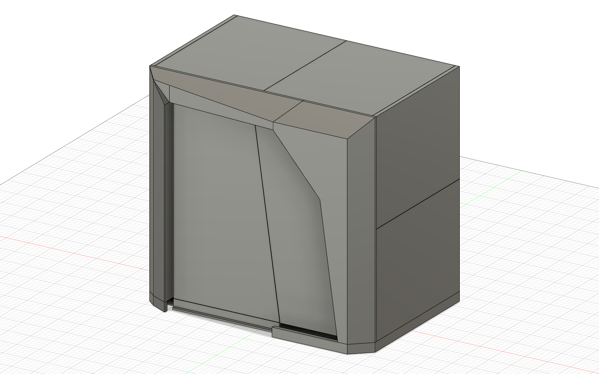
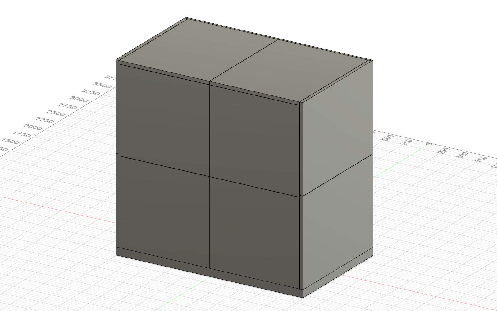
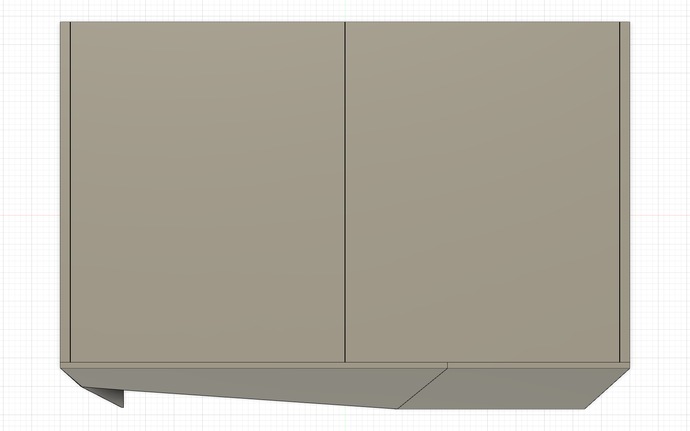
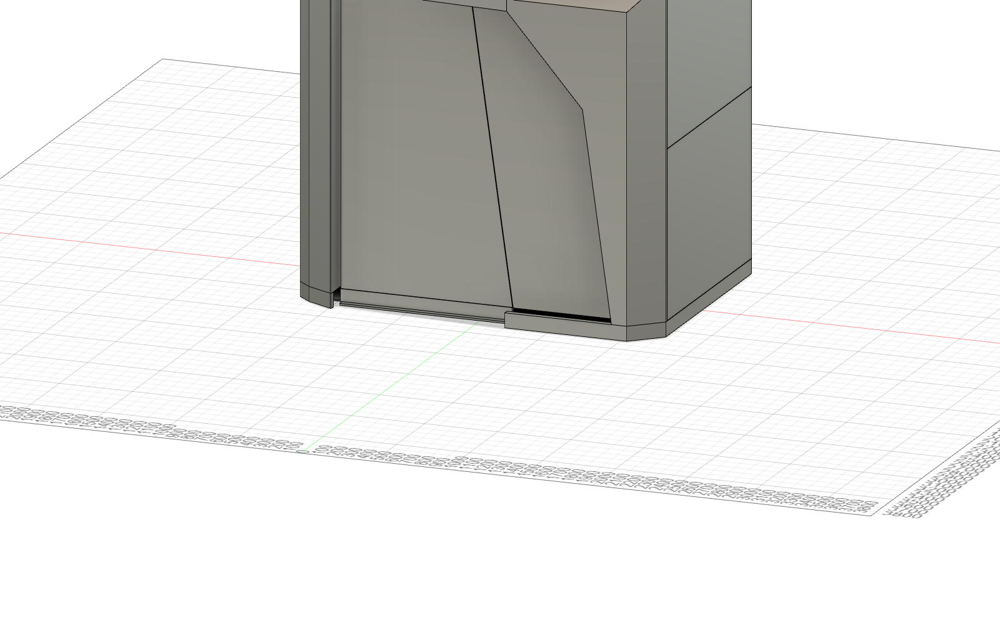

<!-- 100000_P04_POD-ASSEMBLY-GUIDE_INS.md is generated by v2/07-Packaging/pack.py from v2/07-Packaging/templates/assembly-guide.md. Edit the template or the script, never the generated file. -->
# Assembly guide: Spaceship (FocusPod v2), 2 people, one 5 mm hex key

| Doc code | Part number | Revision | Status | Date | Owner |
|---|---|---|---|---|---|
| V2-INS-001 | 100000 POD · Pod hoàn chỉnh | P04 | DRAFT | 2026-10-31 | Packing and Assembly Engineer |

Revision P04 is the pod's own revision: this guide is built on skeleton P04, and the files of part 100000 share one revision (conventions §7 and §8). This is the guide's first issue. It follows the general assembly and the subassembly drawings when they exist and doesn't replace them (guideline §5.1). Labels like **1-07** are the packing labels of [`910000_P01_PACKAGING-PLAN_PKG.md`](../../07-Packaging/910000_P01_PACKAGING-PLAN_PKG.md); every number carries a status (conventions §9).

## Result

1. **Two people, one 5 mm hex key, 21 steps: about {{CLOCK_MIN}} minutes ({{CLOCK_PH}} person-hours)** on the layout study's unit times. That is inside REQ-ASM-01's 4-hour limit and well over its "about 1 hour" target; the timed trial on the prototype decides, and section 6 shows where the time goes.
2. **{{REG_BOLTS}} bolts of the joints register, each captive in its part: {{N16}} × {{PN16}} (M6 × 16) and {{N25}} × {{PN25}} (M6 × 25) pins and lock screws**, each with its {{PNW}} washer already on. They match the register joint by joint (section 5). Every site fixing is in the register now: the corner keys hook in and DL and DR stand on spigots, with no site bolts (J-BASE-02, J-FRONT-02); the door hinges and the air parts' fixings in DR stay on hold there.
3. **Every part weighs 20 kg or less except the glass** (D-03). The door unit ({{DOOR_KG}} kg) and the fixed glass ({{FIX_KG}} kg) are carried by both people with 2 suction lifters.
4. **Order rules:** all walls before the front; the ceiling closes by order (its side walls' top corner bolts stay finger-tight until both halves are in, R-J9); the door hangs before DT (PM ruling); DR's bolts are driven before the air column stands (J-FRONT-01); every bolt before the linings that cover its bay.
5. **Pictures:** each step with parts in the skeleton has a picture from the Fusion model (skeleton P04's part envelopes): the step's new parts solid, the parts fitted before faded. The four renders below show the whole pod. Pictures of the real parts replace the envelopes as each part's CAD merges.

| Front, from the right and above | Back, from the left and above |
|---|---|
|  |  |
| **Plan** | **Front base band, threshold and DR on the band** |
|  |  |

## 1. Before you start

- **The crew.** Person A leads the lifting and holds each part in place; Person B drives the bolts from inside. Both lift the glass, the long parts and anything overhead.
- **The one tool** is the 5 mm ball-end hex key {{PNKEY}}, in the OPEN FIRST kit (109000, label {{KIT_TAG}}). Nothing else counts as a tool (REQ-ASM-03).
- **Handling aids** (not tools: ISS-047, ISS-064): 2 suction lifters (two-cup, each rated 40 kg or more; assumption), 2 step stools with 2 treads, a 600 mm spirit level, a utility knife for straps and film, cut-resistant gloves and safety shoes.
- **The room:** a flat floor within ±5 mm (the glides take it up; ISS-054), a door at least 810 mm wide (REQ-ASM-06), room around the 2500 × 1700 footprint to lay the parts out, and a 220 V socket for the mains inlet (prototype, REQ-SCP-02), connected by a qualified electrician.
- **Directions:** left and right as seen from outside, facing the door (conventions §4). Position codes: walls L1 and L2 (left, lower and upper), R1 and R2 (right), B1 to B4 (back: lower left, lower right, upper left, upper right); ceiling C1 (left) and C2 (right); floor F1 and F2; decor blocks DL, DR, DT.
- **The clock** (REQ-ASM-01; its start and stop are PROPOSED): it starts with the pallets unwrapped on site and stops with the pod closed, powered and the fans running, after the final check (step 21). Step 22 fits the ledge after the clock.

## 2. Safety

- **Glass.** The door unit is {{DOOR_KG}} kg and the fixed glass {{FIX_KG}} kg: always both people and both suction lifters. Check each lifter's vacuum before every lift. Carry glass upright, never flat and never over anyone. Set it down only on the padded glass rests or in its channel, never on a corner or a hard floor. Leave the protective film on. The glass stays in its crate until its step.
- **Weight.** Every other part is 20 kg or less (D-03); parts longer than 1.6 m or heavier than 15 kg are carried by both people.
- **Height.** One person on a step stool at a time, the other hands up. The ceiling halves, the soffit, its cartridge, DT and the ceiling linings are lifted by both people.
- **Hands.** Keep fingers off the joint faces while a panel is lowered onto its spigots and while a bolt pulls a seam shut.
- **Bolts.** Hand tools only. The tightening torque is on HOLD until the rivnut test T06 (HOLD-01, D-48): turn until the seam closes onto its stop and the bolt stops; no extension bars, no power drivers.
- **Electrics.** Power stays off until step 20. Only a qualified electrician connects the mains inlet; everything else runs on 12 V (D-10).
- **Packaging.** Hold a strap while cutting it. Keep film and foam off the walking area.

## 3. How the joints work (read once)

- **Captive bolts.** Each bolt sits in the edge tube of the part placed second, with its washer, pulled back and held by a grommet (joints register 2.2). You only turn it: the key goes through the Ø19 hole from the 60 × 60 fill pocket in that panel's bay.
- **Spigots.** Every wall and ceiling part stands on two Ø8 spigots, a round hole at one end and a slot at the other, before its first bolt (REQ-ASM-04). If a part doesn't drop on, lift it and seat it again; never force it.
- **Two bolts, one key.** {{PN16}} (M6 × 16) for the {{N16}} other bolts: each pulls its joint onto its 2.26 mm metal stop or its seat. {{PN25}} (M6 × 25) pins at the 10 closing-seam positions (B1–B2, B3–B4, C1–C2): snug only, they hold the faces level and pull nothing (joints register 2.10). Two more lock the soffit on its hanger studs (J-AIR-01).
- **Order of tightening** (joints register 2.7, R-J9): closing-seam pins first, then the stopped seams; the side walls' top corner bolts and the ceiling's side bolts last, once both ceiling halves are in.
- **Linings last.** Every bolt is driven through a bay that a lining cassette covers later, so check each wall's bolts before its cassette goes on.

## 4. Steps

{{STEPS}}

## 5. Bolts against the joints register

The guide's register bolts, joint by joint, against {{REG_SRC}}:

{{BOLTS}}

Joints with no site bolts, and the fixings still on hold or not designed (the joints register's section 3.9 and its HOLD list):

{{OTHER_FIXINGS}}

## 6. Time

{{TIME_TABLE}}

Each step's time is its 2-person work plus half its 1-person work (shared between the two), plus 15% for hand-offs, the layout study's model (`scripts/assembly.py`). Where the time goes:

{{TOP_STEPS}}

**D-87 (PM, 2026-10-31) cut the clock from 168 minutes (PR #52) to the {{CLOCK_MIN}} above.** The PM took four of the five fixes priced on the earlier model, and they are in the steps now:

| Fix | Steps | Priced on the 168-minute model | Owner |
|---|---|---:|---|
| The exhaust fan box fitted inside the soffit and the intake riser joined to the supply fan box at the factory, plug-in connectors, tool-free hooks for the soffit and the column, one hinged soffit underside | 15 to 17 | 11.4 min (calculation) | AIR (CEILING Engineer), FRONT |
| Glides preset at the factory, corner keys that hook in (12 fewer bolts), band pieces that locate on the keys | 2 | 11.8 min (calculation) | BASE, Joints Engineer |
| The floor foam bonded under the floor panels at the factory, and every pallet 2 part set down at its place in step 1 | 1, 3 and every carry | 10.7 min (calculation) | Packing, BASE |
| A factory-tested plug-in harness and a self-test button on the hub | 13, 20 | 8.1 min (calculation) | ELECTRICAL |

The fifth, moving the film peeling after the clock, was rejected so the number stays honest. Instead the film covers only the {{FILM_FACES}} faces that show (the 8 wall skins, the 3 decor blocks and both faces of both glass panes; none on the roof skins) and each panel has a quick-release tab. Peeling now takes about {{FILM_MIN}} minutes of the clock, against {{FILM_ALL_MIN}} for film on all {{FILM_FACES_ALL}} faces without tabs: {{FILM_SAVES}} minutes saved. The layout study's 168 minutes didn't count film at all, so this is time the clock now carries honestly.

The 1-hour target needs more than this: the timed trial showing faster unit times than the layout study assumed, or fewer loose pieces and bolts. The {{REG_BOLTS}} register bolts alone take about {{REG_BOLT_MIN}} minutes of the clock. For scale, hushMeet takes 2 installers 2.5 to 3 hours (source: the market study, as the layout study §4 quotes it).

Unit times used:

{{UNIT_TIMES}}

## 7. Final check list (step 21)

- [ ] Door: swings out to 90 degrees and back with no rub; 4 mm under DT along the head; 7 mm running gap over the threshold; closes onto DT's magnetic catch 368007 and stays shut (no lock, D-83); the drop seal comes down onto the threshold's land when closed.
- [ ] Seals: with the pod lit and the room dark, no light at any seam, at the door's edges or at the fixed glass's edges.
- [ ] Bolts: all {{REG_BOLTS}} register bolts driven, the 10 pins snug, the 6 upper corner bolts tightened after the ceiling; the other fixings of section 5 done.
- [ ] Linings: all 10 cassettes on their clips, both ceiling cassettes on their safety catches, none touching anything but its clips.
- [ ] Air: both fan pairs run; air leaves the kick grille at the column's foot and enters the soffit grille; boost works; the hub shows CO2.
- [ ] Lights: the light shelf works in every scene, including 'call' (D-70).
- [ ] Film peeled from the ACP and the glass; packaging off site; floor clean.

## 8. Taking it down

Power off at the mains first. Then the reverse order: ledge; ceiling linings (unhook the catches first); soffit underside, exhaust fan box, exhaust cartridge, soffit; air column front face, supply cartridge, air column (it must come out before DR's bolts can be reached, J-FRONT-01); DR's inner face, supply fan box, intake riser; wall linings; DT; the door; DR, then the fixed glass with both lifters; DL; the ceiling (loosen the side walls' top corner bolts first); the upper walls, the lower walls; floor; base band. Pack by the labels, into the same places.

## 9. Open items that touch this guide

| What | Owner | Status |
|---|---|---|
| Door hinges: the set, how the door's hinge halves meet DL's, the hinge fixings, and holding the door at its closed position (D-83 removed the lock) | FRONT | HOLD (D-46, ISS-002); the PM ruled the hinge halves that sit in DL ship in DL and the hinges must lift off |
| Lining clips and the ceiling safety catch | WALL, CEILING, Hardware Engineer | HOLD (D-47, ISS-076) |
| Bolt torque | Hardware Engineer | HOLD-01 until T06 (D-48) |
| Captive bolt grommet | Joints Engineer | HOLD-02 |
| Fixings of DL and DR to the band and DR's support, DT to DL, DR and the ceiling | FRONT, BASE | counts assumed (section 5) |
| How DR slides onto the fixed glass's channels without dragging its back-plate gasket over the side walls' front edges | FRONT | to check in FRONT's model |
| Air column, soffit and fan box fixings; the soffit's fit between the side linings | AIR (CEILING Engineer) | not designed yet |
| Light shelf, ledge, screen rail | INTERIOR | parts designed (810201, 810101); the ledge brackets 818101 and the screen rail 818102 on HOLD; their fixings not listed yet (D-70) |
| Electrical connectors and the wiring diagram | ELECTRICAL | not designed yet |
| Step pictures from the Fusion model | Packing and Assembly | after each part's CAD lands and the screen is unlocked |

## 10. Sources

Decision log D-03, D-04, D-08, D-47, D-59 to D-78; requirements REQ-ASM-01 to -11, REQ-LGT-02, -03, REQ-SHP-01, -02; the joints register (PR #23); the layout study's P04 roll-up and its time model; skeleton P04; the FRONT door unit and fixed glass (PRs #27, #28); the CEILING cassette (PR #32); the BASE P01 corner; the air report sections 7e and 7f; PM rulings in the packing group, 2026-10-31.
